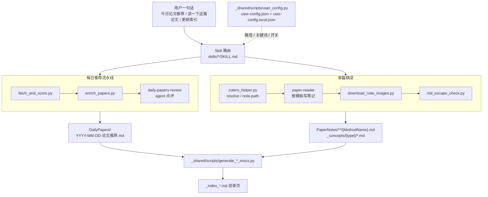
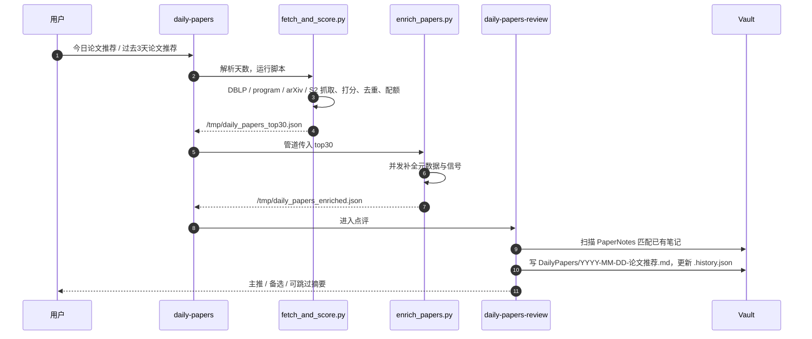
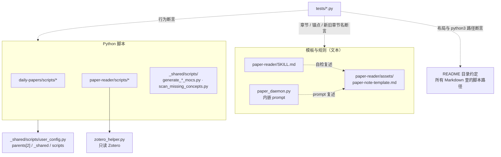

> 一份面向日常研发的 dailypaper-skills 说明书：解释它是什么、每日推荐与单篇精读两条流水线如何把 skill 指令和 Python 脚本串起来、笔记模板和概念库的约束从哪里来、怎样安装和配置，以及排查问题时优先看哪些源码和测试。

源仓库：`https://github.com/BeenLi/dailypaper-skills`

本次分析的本地路径：`<repo>`（本机 checkout；写进仓库的文档不记录机器路径）

本次分析的提交：`8648b4b 2026-10-12 polish: resolve review minors (fig placeholders, formula-location rule, diag anchor placement, route reporting, per-route draw.io gating, rule-file paths, generic hard-link doc)`

## 1. 一句话理解 dailypaper-skills

`dailypaper-skills` 是一组面向 systems / architecture / networking / LLM systems 方向的 agent skills 加 Python 辅助脚本：agent（Codex 或 Claude Code）负责理解用户意图、写推荐点评和长篇论文笔记，Python 负责确定性的抓取、打分、去重、Zotero 读取、路径规划、目录页生成和文本检查。定位写在 `README.md` 开头和 `skills/daily-papers/SKILL.md`。

仓库由四条主线组成：`skills/daily-papers*`（每日推荐流水线：`daily-papers` 是一句话入口，`daily-papers-fetch` / `daily-papers-review` / `daily-papers-notes` 是三步）、`skills/paper-reader`（单篇或批量论文精读，含 Zotero 集成和笔记模板）、`skills/book-reader`（整本书读书笔记与思维导图）、`skills/_shared`（所有 skill 共用的配置加载、MOC 生成、概念扫描、Markdown 转义检查和画图规则）。`skills/generate-mocs` 是手动刷新目录页的入口。`tests/` 用 pytest 钉住脚本行为和文档约束。

它不是常驻服务，也不是 Obsidian 插件：核心输入是用户的一句自然语言、共享配置 `skills/_shared/user-config.json`（及本机覆盖 `user-config.local.json`）、Zotero 的 SQLite 库和 PDF 附件；核心输出是 Obsidian vault 里的 `DailyPapers/YYYY-MM-DD-论文推荐.md`、`PaperNotes/**/{MethodName}.md` 论文笔记、`_concepts/{concept_type}/*.md` 概念笔记和 `_index_*.md` 目录页。

四条贯穿所有 skill 的原则（`README.md`、`skills/paper-reader/SKILL.md`、`skills/daily-papers/SKILL.md`）：论文目录由 Zotero collection path 决定，不靠关键词猜分类；概念目录由 `concept_type` 决定，不按论文研究领域分类；Zotero 默认只读，写 collection 只能在用户明确要求后执行；每日推荐默认只做 fetch + review，不自动精读生成长笔记。

## 2. 核心心智模型

| 概念 | 来源 | 含义 |
|---|---|---|
| Skill | `skills/*/SKILL.md` | 用户意图到具体流程的入口说明；frontmatter 的 `description` 决定触发词，正文是 agent 要执行的步骤。 |
| 三步流水线 | `skills/daily-papers/SKILL.md`、`skills/daily-papers-fetch/SKILL.md`、`skills/daily-papers-review/SKILL.md`、`skills/daily-papers-notes/SKILL.md` | 抓取 → 点评 → 可选精读。`daily-papers` 默认只串前两步，精读由用户决定。 |
| 共享配置 | `skills/_shared/scripts/user_config.py`、`skills/_shared/user-config.json` | 三层合并：内置 `DEFAULT_CONFIG` → `user-config.json` → `user-config.local.json`；所有脚本和 SKILL 都从这里取 vault、Zotero、关键词和自动化开关。 |
| 论文笔记模板 | `skills/paper-reader/assets/paper-note-template.md` | 唯一的笔记模板，固定章节顺序 问题定义 → 动机实验与核心 Insights → 系统设计总览 → 关键机制拆解 → …，并规定锚点与跳转写法。 |
| 模板的四份拷贝 | `skills/paper-reader/SKILL.md`、`skills/paper-reader/scripts/paper_daemon.py`、`tests/test_systems_template.py` | 模板结构同时写在 SKILL 自检、daemon 内嵌 prompt 和测试断言里，改模板必须四处同步。 |
| Zotero helper | `skills/paper-reader/scripts/zotero_helper.py` | 只读解析 item / collection / PDF，规划笔记保存路径，用 `NoteIndex` 匹配已有笔记。 |
| concept_type | `skills/paper-reader/references/concept-categories.md` | 概念库按概念本身性质分 8 类（data-structure … theory-model），不按论文领域分；seed vocabulary 列出必须成为 `[[概念]]` 的术语。 |
| MOC | `skills/_shared/scripts/moc_builder.py`、`generate_paper_mocs.py`、`generate_concept_mocs.py` | 递归生成每个目录的 `_index_<目录名>.md` 导航页，内容不变时不重写。 |
| 画图规则 | `skills/_shared/references/diagram-rules.md`、`skills/_shared/references/mermaid-rules.md` | 图表选型表（Mermaid 默认，时序 / 甘特 / 流水线分级图走 draw.io）和 Mermaid 的"渲染 → 看图 → 重排"闭环。 |
| 目录约定 | `README.md` 的"目录约定"、`tests/test_repo_layout.py` | 每个 skill 内 `scripts/` 放可执行代码、`references/` 放 agent 读的规则、`assets/` 放模板；测试扫描所有 Markdown 里的 `python3 …py` 路径必须存在。 |

## 3. 总体架构



图里实线是数据流，虚线是配置。所有入口都先经过 `skills/*/SKILL.md` 的路由，路由时 agent 读 `skills/_shared/scripts/user_config.py` 对应的两个 JSON 取路径、关键词和开关；之后分到两条流水线：每日推荐由 `skills/daily-papers/scripts/fetch_and_score.py` 和 `enrich_papers.py` 产出临时 JSON，再由 `daily-papers-review` 这个纯 agent 步骤写推荐文件；单篇精读由 `skills/paper-reader/scripts/zotero_helper.py` 解析来源和保存路径，agent 按模板写笔记，`download_note_images.py` 做图片本地化，`md_escape_check.py` 做转义检查。两条线的产物最后都被 `skills/_shared/scripts/generate_*_mocs.py` 编进目录页。

### 3.1 组件职责

| 组件 | 关键文件 | 职责 |
|---|---|---|
| `daily-papers` | `skills/daily-papers/SKILL.md` | 一句话入口：解析时间范围，顺序调用 fetch 与 review，默认不调用 notes。 |
| `daily-papers-fetch` | `skills/daily-papers-fetch/SKILL.md` | 解析 `--days`，运行抓取和富化脚本，检查 `/tmp/daily_papers_enriched.json`。 |
| `fetch_and_score.py` | `skills/daily-papers/scripts/fetch_and_score.py` | DBLP proceedings / journal、会议 program page、arXiv API、Semantic Scholar 抓取；关键词打分、历史去重、时效衰减、来源配额。 |
| `enrich_papers.py` | `skills/daily-papers/scripts/enrich_papers.py` | 并发补全作者、机构、章节标题、图表 caption、首图、`method_name(s)`、`method_summary` 和 `has_*_eval` 信号；机构抽取委托给同目录 `extract_affiliations.py`。 |
| `daily-papers-review` | `skills/daily-papers-review/SKILL.md` | 扫描笔记库匹配已有论文，按主推 / 备选 / 可跳过分流写点评，保存推荐文件并更新 `.history.json`。 |
| `daily-papers-notes` | `skills/daily-papers-notes/SKILL.md` | 为"必读"论文补概念、调用 `paper-reader` 生成笔记、回填笔记链接、刷新 MOC；禁止手写骨架笔记。 |
| `paper-reader` | `skills/paper-reader/SKILL.md` | 接收 PDF / arXiv / Zotero 输入，按模板生成笔记，维护概念库，按 Zotero collection 路径保存。 |
| `zotero_helper.py` | `skills/paper-reader/scripts/zotero_helper.py` | 复制 `zotero.sqlite` 到临时文件并以 `PRAGMA query_only = ON` 打开；`resolve` / `note-path` 是新入口，`move` 等写命令只在用户确认后调用。 |
| `paper_daemon.py` | `skills/paper-reader/scripts/paper_daemon.py` | 按 Zotero collection 批量调用 Codex CLI 生成笔记，进度、日志、PID 写在 `PAPER_DAEMON_STATE_DIR`，支持断点续跑。 |
| `reorganize_notes.py` | `skills/paper-reader/scripts/reorganize_notes.py` | 按 tags 把历史笔记归到分类目录；`--analyze` 只报告，`--execute` 才移动。 |
| `download_note_images.py` | `skills/daily-papers/scripts/download_note_images.py` | 检查笔记外链图片可达性，不可达的下载到 `00_assets/` 并改写为 wikilink。 |
| `user_config.py` | `skills/_shared/scripts/user_config.py` | 三层配置合并与路径访问函数；`git_push` 在 `git_commit=false` 时被压成 false。 |
| MOC 生成 | `skills/_shared/scripts/moc_builder.py`、`generate_paper_mocs.py`、`generate_concept_mocs.py`、`clean_old_mocs.py` | 递归生成 / 清理目录页；排除 `_inbox`、`00_assets` 和 `.` 开头目录按脚本各自设定。 |
| 概念维护 | `skills/_shared/scripts/scan_missing_concepts.py`、`regenerate_concepts.py` | 扫描"有 wikilink 但没有概念笔记"的盲点；批量按增强模板重写历史概念。 |
| 文本检查 | `skills/_shared/scripts/md_escape_check.py` | 找出 / 修复会被 Obsidian 误渲染的 `[i][j]`、`$`、误触发 `#tag`。 |
| 链接复查 | `skills/paper-reader/scripts/check_note_links.py` | 检查笔记里的标题 / 块链接、重复锚点、`[[概念]]` 与嵌入能否解析、表格行内未转义的 `\|`、漏写链接的裸 Figure / Table / 机制引用。 |
| `book-reader` | `skills/book-reader/SKILL.md`、`skills/book-reader/scripts/extract_book.py` | 整本书逐页提取、分批提炼、输出带树状思维导图的读书笔记。 |
| 测试 | `tests/*.py` | 13 个测试文件：脚本行为、模板章节与锚点约束、SKILL / daemon 一致性、仓库布局与文档路径。 |

## 4. 项目如何工作

### 4.1 一次"今日论文推荐"的主链路



1. `skills/daily-papers/SKILL.md` 把"今日 / 过去 3 天 / 过去一周"解析成天数，依次调用 `daily-papers-fetch` 和 `daily-papers-review`，默认不调用 `daily-papers-notes`。
2. `skills/daily-papers-fetch/SKILL.md` 运行 `python3 skills/daily-papers/scripts/fetch_and_score.py --days N`。脚本里 `fetch_dblp_papers`、`fetch_conference_program_papers`、`fetch_arxiv_papers`、`fetch_semantic_scholar_papers` 产生候选，`score_paper` 按配置的 `keywords` / `domain_boost_keywords` / `negative_keywords` 打分，`merge_and_dedup` 用 `paper_lookup_keys` 和 `dedup_key` 合并，`apply_age_decay` 压低旧会议论文，`select_with_quota` 限制非 arXiv 来源占比。
3. `python3 skills/daily-papers/scripts/enrich_papers.py` 读 stdin 的候选，按 arXiv / DOI / Semantic Scholar / OpenAlex 补全，`extract_has_hardware_eval` 等函数给出点评要用的信号，写出 `/tmp/daily_papers_enriched.json`。
4. `skills/daily-papers-review/SKILL.md` 只基于富化数据写点评：`has_hardware_eval=false` 不进主推，缺 end-to-end 评测的 serving 论文最多备选；保存到 `{DAILY_PAPERS_PATH}/YYYY-MM-DD-论文推荐.md` 并更新 `.history.json`（保留 30 天）。
5. 下一次抓取时，`fetch_and_score.py` 的 `build_history_index` 读回 `.history.json` 做历史去重；候选不足时 `load_fallback_ids` 允许回填并标 `is_re_recommend`。

`score_paper` 的打分信号（`skills/daily-papers/scripts/fetch_and_score.py`）：

| 信号 | 行为 |
|---|---|
| `keywords` 命中标题 / 摘要 | 每个 +3 / +1 |
| `domain_boost_keywords` 命中 | 阶梯加分 |
| 已知 venue 或 systems phrase | 加分 |
| `negative_keywords` 命中标题 | 直接 -999 硬排除；只命中摘要不排除 |

### 4.2 一篇论文从输入到 Obsidian 笔记

1. `skills/paper-reader/SKILL.md` 先读共享配置得到 `NOTES_PATH` / `CONCEPTS_PATH` / `ZOTERO_DB` 等变量，再按输入类型分流：PDF 直接读，arXiv 优先 HTML，Zotero 通过 `python3 skills/paper-reader/scripts/zotero_helper.py resolve --item-id | --query | --collection`。
2. 多候选 item 或 item 属于多个 collection 时，SKILL 要求把 `item_id / title / collection_paths` 列给用户选择；选定后 `zotero_helper.py note-path` 规划 `{NOTES_PATH}/{collection_path}/{MethodName}.md`，无 collection 落到 `_inbox/`。
3. agent 严格按 `skills/paper-reader/assets/paper-note-template.md` 写笔记：问题定义（范围、问题、设计空间）→ 动机实验与核心 Insights（证据只出现一次，每个 Insight 以设计启发收尾）→ 系统设计总览（优先论文原图，一图一表一段走读）→ 关键机制拆解 → 实验设置 → 核心结果 → Overhead 与兼容性 → 批判性思考 → 复现 → 关联笔记 → 速查卡片；Figure / Table / 公式 / 贡献挂 `^id` 锚点，正文引用写 `[[#^id|…]]`。自画图按 `skills/_shared/references/diagram-rules.md` 选 Mermaid 或 draw.io。
4. 图片优先外链 arXiv HTML；本地 PDF 裁图写到笔记同目录 `00_assets/<note-name>_<原图片名>`（规则在 `skills/paper-reader/references/image-troubleshooting.md`）；保存后 `python3 skills/daily-papers/scripts/download_note_images.py <笔记>` 把不可达外链本地化并把 frontmatter `image_source` 改为 `mixed`。
5. 扫描笔记里的 `[[概念]]`，在 `CONCEPTS_PATH` 递归查找，缺失的按 `skills/paper-reader/references/concept-categories.md` 的 8 类和增强模板创建；写完跑 `python3 skills/_shared/scripts/md_escape_check.py <笔记>` 和 `python3 skills/paper-reader/scripts/check_note_links.py <笔记>`，后者修到输出 `OK` 为止。
6. `AUTO_REFRESH_INDEXES=true`（默认）时运行 `python3 skills/_shared/scripts/generate_concept_mocs.py` 和 `generate_paper_mocs.py` 刷新目录页；`GIT_COMMIT_ENABLED` 默认 false，不提交 vault。

### 4.3 批量模式：Zotero collection 到一组笔记

1. `python3 skills/paper-reader/scripts/paper_daemon.py --collection "<名称>"` 递归取 collection 下的 item，去重后用 `source_collection_path` 规划路径。
2. 对每篇论文，daemon 调用 `skills/paper-reader/scripts/zotero_helper.py` 的 `build_note_index` 和 `find_matching_notes`，按 `zotero_item_id → doi → arxiv_id → 标题 → 文件名` 顺序查已有笔记，命中则跳过。
3. 剩下的逐篇拼出含模板规则的 prompt，调用 `PAPER_DAEMON_CODEX_BIN`（默认 `codex`）在 `PAPER_DAEMON_CODEX_WORKDIR`（默认 vault）生成笔记，进度写 `paper_daemon_progress.json`，`--status` 查看、`--no-resume` 从头开始。

### 4.4 配置如何到达每个脚本

1. `skills/_shared/scripts/user_config.py` 的 `load_user_config` 以 `DEFAULT_CONFIG` 为底，依次深合并同目录上一级的 `user-config.json` 和 `user-config.local.json`（`lru_cache` 只读一次）。
2. 其他目录的脚本用 `Path(__file__).resolve().parents[2] / "_shared" / "scripts"` 把该目录加进 `sys.path` 再 `from user_config import …`，例如 `skills/daily-papers/scripts/fetch_and_score.py` 和 `skills/paper-reader/scripts/zotero_helper.py`。
3. SKILL.md 侧不读 Python，而是让 agent 直接读两个 JSON 并派生 `VAULT_PATH`、`NOTES_PATH = {VAULT_PATH}/{paper_notes_folder}` 等变量，见 `skills/daily-papers-notes/SKILL.md` 的 Step 0。

### 4.5 关键数据与路径

vault 内的布局（`README.md`、`skills/daily-papers-review/SKILL.md`、`skills/paper-reader/SKILL.md`）：

```text
<vault>/
├── DailyPapers/
│   ├── YYYY-MM-DD-论文推荐.md
│   └── .history.json
└── PaperNotes/
    ├── Research Topics/.../{MethodName}.md
    ├── _concepts/{concept_type}/{ConceptName}.md
    ├── _inbox/{MethodName}.md
    ├── <分类目录>/00_assets/<note-name>_<原图片名>
    └── _index_*.md
```

| 数据 | 生产者 | 消费者 |
|---|---|---|
| `/tmp/daily_papers_top30.json` | `skills/daily-papers/scripts/fetch_and_score.py` | `enrich_papers.py`（stdin） |
| `/tmp/daily_papers_enriched.json` | `skills/daily-papers/scripts/enrich_papers.py` | `daily-papers-review`、`daily-papers-notes` |
| `DailyPapers/.history.json` | `skills/daily-papers-review/SKILL.md`（保留 30 天） | `fetch_and_score.build_history_index` 历史去重 |
| 论文笔记 frontmatter（`zotero_item_id`、`doi`、`arxiv_id`、`method_name`） | `skills/paper-reader/SKILL.md` | `zotero_helper.NoteIndex` 匹配已有笔记；`_inbox` 纳入索引，`_concepts` 与 `_index_*.md` 排除，多个笔记共享同一精确 ID 时返回 conflict 不静默选择 |
| 概念笔记 frontmatter（`concept_type`、`tags`） | `paper-reader` / 手工维护 | `generate_concept_mocs.py`、`scan_missing_concepts.py` |
| `~/.codex/paper_daemon_progress.json` | `skills/paper-reader/scripts/paper_daemon.py` | 同一脚本断点续跑 |

### 4.6 概念库的 8 个类型

`skills/paper-reader/references/concept-categories.md` 是唯一信源；paper-method 不是正式类型，论文首创且只在本论文实验的概念落到最接近的类型并加 `status/paper-specific` 标签，被多篇独立工作当 baseline 后再升格。

| concept_type | 含义 |
|---|---|
| `data-structure` | 数据格式、表示、结构 |
| `algorithm` | 脱离具体系统也成立的计算逻辑 |
| `mechanism` | 绑定系统上下文的运行时策略 |
| `architecture` | 宏观系统架构、服务模式 |
| `hardware` | 硬件部件、计算单元、物理互联 |
| `software-abstraction` | OS、框架层接口与协议 |
| `metric` | 评估指标、测量口径 |
| `theory-model` | 性能数学模型、统计基础 |

## 5. 安装与启动

前置环境来自 `README.md` 的"安装与配置"：Codex CLI 或 Claude Code、Python 3.10+、Obsidian、可选的 Zotero、`poppler`（`pdftotext` / `pdfimages`）、可选的 `mmdc` 用于校验 Mermaid。

把 skills 复制到 agent 的 skills 目录（`README.md`）：

```bash
mkdir -p ~/.codex/skills
cp -R ./skills/* ~/.codex/skills/
```

开发本仓库时改用软链接，这样仓库里的改动立即生效（`README.md`；Claude Code 用户把 `~/.codex/skills` 换成 `~/.claude/skills`）：

```bash
mkdir -p ~/.codex/skills
for d in paper-reader book-reader daily-papers daily-papers-fetch daily-papers-review daily-papers-notes generate-mocs _shared; do
  ln -sfn "$PWD/skills/$d" "$HOME/.codex/skills/$d"
done
```

初始化 Obsidian 目录（`README.md`）：

```bash
VAULT=~/ObsidianVault
mkdir -p "$VAULT/DailyPapers" "$VAULT/PaperNotes/_concepts" "$VAULT/PaperNotes/_inbox"
```

然后在 `skills/_shared/user-config.local.json` 写本机的 `paths.obsidian_vault`、`paths.zotero_db`、`paths.zotero_storage`（该文件被 `.gitignore` 忽略）。安装 draw.io 路线的可选依赖见 `skills/_shared/references/diagram-rules.md`。

## 6. 常用命令 / 使用指南

### 6.1 用户入口（对 agent 说的话）

来自 `README.md` 的"快速入口"和各 SKILL 的触发词：

- `今日论文推荐`、`过去3天论文推荐`、`过去一周论文推荐`（`skills/daily-papers/SKILL.md`）
- `读一下这篇论文 <arXiv 链接或 PDF 路径>`、`快速看一下这篇论文 …`、`批判性分析这篇论文 …`（`skills/paper-reader/SKILL.md`）
- `读一下 Zotero item 2487`、`读一下 Zotero 里的 vLLM`、`批量读一下 Zotero 里 <collection> 分类下的论文`
- `更新索引`（`skills/generate-mocs/SKILL.md`）
- 调试单步：`跑一下论文抓取`、`跑一下论文点评`、`跑一下论文笔记`

### 6.2 直接运行脚本

以下路径相对仓库根目录；装成 skills 后把 `skills/` 换成 skills 目录。

```bash
python3 skills/daily-papers/scripts/fetch_and_score.py --days 3 > /tmp/daily_papers_top30.json
cat /tmp/daily_papers_top30.json | python3 skills/daily-papers/scripts/enrich_papers.py /tmp/daily_papers_enriched.json
python3 skills/paper-reader/scripts/zotero_helper.py resolve --query "vLLM"
python3 skills/paper-reader/scripts/zotero_helper.py note-path <MethodName> --collection "<collection path>"
python3 skills/paper-reader/scripts/paper_daemon.py --collection "<collection>"   # --status / --list / --no-resume
python3 skills/daily-papers/scripts/download_note_images.py "<笔记路径>"
python3 skills/_shared/scripts/generate_concept_mocs.py
python3 skills/_shared/scripts/generate_paper_mocs.py
python3 skills/_shared/scripts/clean_old_mocs.py            # 默认 dry-run，--apply 才删除
python3 skills/_shared/scripts/scan_missing_concepts.py --dry-run
python3 skills/_shared/scripts/scan_missing_concepts.py --with-seed --output /tmp/missing_concepts.csv
python3 skills/_shared/scripts/regenerate_concepts.py --dry-run   # --write-prompts / --apply / --diff / --install
python3 skills/_shared/scripts/md_escape_check.py --fix "<笔记或目录>"
```

命令来源：`README.md` 的"开发维护"和"概念库"小节、各脚本的 argparse 定义（`fetch_and_score.py` 的 `--date` / `--days`，`clean_old_mocs.py` 的 `--apply` / `--papers-only` / `--concepts-only`，`regenerate_concepts.py` 的五种模式）。`zotero_helper.py` 的旧命令 `papers` / `search` / `info` / `find-collection` 仍可用但打印 deprecation 提示，`DEPRECATED_COMMAND_REPLACEMENTS` 指向 `resolve`。

### 6.3 开发与验证

```bash
python3 -m pytest tests/ -q
git diff --check
```

`tests/test_repo_layout.py` 会扫描所有 Markdown 里的 `python3 …py` 路径并断言文件存在，所以移动脚本后先跑测试再改文档。

## 7. 配置项与环境变量

配置文件只有两个：`skills/_shared/user-config.json`（仓库默认，可提交）和同目录 `user-config.local.json`（本机覆盖，`.gitignore` 忽略）。键名与默认值定义在 `skills/_shared/scripts/user_config.py` 的 `DEFAULT_CONFIG`：

| 配置键 | 默认值（`DEFAULT_CONFIG` → `user-config.json`） | 作用 | 读取方 |
|---|---|---|---|
| `paths.obsidian_vault` | `~/ObsidianVault` → 仓库作者机器的路径，必须在 local 里覆盖 | vault 根目录 | 所有 skill 与脚本 |
| `paths.paper_notes_folder` | `论文笔记` → `PaperNotes` | 论文笔记目录 | `paper_notes_dir()` |
| `paths.daily_papers_folder` | `DailyPapers` | 每日推荐目录 | `daily_papers_dir()` |
| `paths.concepts_folder` | `_概念` → `_concepts` | 概念库目录（在笔记目录下） | `concepts_dir()` |
| `paths.zotero_db` / `zotero_storage` / `zotero_base_attachment_path` | `~/Zotero/zotero.sqlite` / `~/Zotero/storage` / 空 → 本机路径 | Zotero 库、附件目录、linked file 基目录 | `zotero_helper.py`、`paper_daemon.py` |
| `daily_papers.keywords` | 20 个 LLM systems 关键词 | 标题 +3 / 摘要 +1 | `fetch_and_score.score_paper` |
| `daily_papers.negative_keywords` | 机器人、医学、纯 NLP 等 | 命中标题直接 -999；只命中摘要不排除 | `score_paper` |
| `daily_papers.domain_boost_keywords` | `llm`、`gpu`、`rdma` … | 阶梯加分 | `score_paper` |
| `daily_papers.arxiv_categories` | `cs.AR cs.DC cs.NI cs.OS cs.PL cs.AI cs.LG` | arXiv 抓取分类 | `fetch_arxiv_papers` |
| `daily_papers.min_score` / `top_n` | 2 / 20 | 入选阈值与候选上限 | `merge_and_dedup`、`select_with_quota` |
| `automation.auto_refresh_indexes` | true | 生成笔记后是否刷新 MOC | `daily-papers-notes`、`paper-reader` |
| `automation.git_commit` / `git_push` | false / false | 是否自动提交、推送 vault；`git_push` 仅在 `git_commit=true` 时生效 | `user_config.git_push_enabled` |
| `mocs.filename_prefix` | `_index_` | 目录页文件名前缀 | `moc_builder.py` |

环境变量只有批量守护进程在用（`skills/paper-reader/scripts/paper_daemon.py`）：

| 环境变量 | 默认值 | 作用 |
|---|---|---|
| `PAPER_DAEMON_STATE_DIR` | `~/.codex` | 进度 `paper_daemon_progress.json`、日志 `paper_daemon.log`、`paper_daemon.pid` 所在目录 |
| `PAPER_DAEMON_CODEX_BIN` | `codex` | 调用的 agent CLI |
| `PAPER_DAEMON_CODEX_WORKDIR` | vault 根目录 | agent 运行目录 |
| `PAPER_DAEMON_CODEX_MODEL` | 空 | 传给 CLI 的模型名 |
| `PAPER_DAEMON_CODEX_ARGS` | 空 | 附加参数 |

画图路线的可选覆盖 `DRAWIO_SKILL_DIR`、`VERILOG_DIAGRAM_DIR` 定义在 `skills/_shared/references/diagram-rules.md`。

## 8. 常见使用场景 / 推荐工作流

1. **每天早上看推荐**：对 agent 说 `今日论文推荐`；想看多天说 `过去一周论文推荐`。产物在 `DailyPapers/`，不会自动精读。入口 `skills/daily-papers/SKILL.md`。
2. **精读一篇推荐里的论文**：`读一下 <论文标题或链接>`；笔记按 Zotero collection 路径保存，没有 collection 进 `_inbox/`。规则 `skills/paper-reader/SKILL.md` 第 4 节。
3. **把 Zotero 某个分类整体读完**：`批量读一下 Zotero 里 <collection> 分类下的论文`，或后台跑 `python3 skills/paper-reader/scripts/paper_daemon.py --collection "<collection>"`，中断后 `--status` 查进度再续跑。
4. **发现笔记里引用了却没建的概念**：`python3 skills/_shared/scripts/scan_missing_concepts.py --with-seed --output /tmp/missing_concepts.csv`，按 `skills/paper-reader/references/concept-categories.md` 补齐。
5. **手动整理 / 移动笔记后刷新导航页**：`更新索引`，或直接跑 `python3 skills/_shared/scripts/generate_paper_mocs.py` 与 `generate_concept_mocs.py`；重复运行幂等。
6. **改了笔记模板**：同步 `skills/paper-reader/SKILL.md` 的自检、`skills/paper-reader/scripts/paper_daemon.py` 的 prompt、`tests/test_systems_template.py`，然后 `python3 -m pytest tests/ -q`。
7. **读一本书**：`帮我读这本书 <PDF/EPUB>`，由 `skills/book-reader/SKILL.md` 调 `extract_book.py` 分批提炼并画树状导图。

## 9. 源码入口索引

| 想了解 | 优先看 |
|---|---|
| 用户入口与触发词 | `skills/daily-papers/SKILL.md`、`skills/paper-reader/SKILL.md`、`skills/generate-mocs/SKILL.md`、`skills/book-reader/SKILL.md` |
| 抓取来源与打分 | `skills/daily-papers/scripts/fetch_and_score.py`（`score_paper`、`merge_and_dedup`、`select_with_quota`、`VENUE_MONTH_HINTS`） |
| 历史去重 | `fetch_and_score.py` 的 `paper_lookup_keys`、`dedup_key`、`build_history_index`、`load_fallback_ids` |
| 元数据富化与点评信号 | `skills/daily-papers/scripts/enrich_papers.py`、`extract_affiliations.py`、`parse_arxiv.py` |
| 点评规则与分流 | `skills/daily-papers-review/SKILL.md` |
| 批量笔记与回填 | `skills/daily-papers-notes/SKILL.md` |
| 论文笔记模板与写作约束 | `skills/paper-reader/assets/paper-note-template.md`、`skills/paper-reader/references/quality-standards.md` |
| 图片获取与本地化 | `skills/paper-reader/references/image-troubleshooting.md`、`skills/daily-papers/scripts/download_note_images.py` |
| 概念分类与增强模板 | `skills/paper-reader/references/concept-categories.md` |
| Zotero 解析与笔记匹配 | `skills/paper-reader/scripts/zotero_helper.py`（`NoteIndex`、`plan_note_save`、`resolve`） |
| Zotero 批量 | `skills/paper-reader/scripts/paper_daemon.py` |
| 配置加载 | `skills/_shared/scripts/user_config.py` |
| MOC 生成 | `skills/_shared/scripts/moc_builder.py`、`generate_concept_mocs.py`、`generate_paper_mocs.py`、`clean_old_mocs.py` |
| 概念扫描与批量重写 | `skills/_shared/scripts/scan_missing_concepts.py`、`regenerate_concepts.py` |
| Markdown 转义检查 | `skills/_shared/scripts/md_escape_check.py` |
| 画图规则 | `skills/_shared/references/diagram-rules.md`、`skills/_shared/references/mermaid-rules.md`、`skills/book-reader/references/mindmap-rules.md` |
| 仓库布局与文档路径约束 | `tests/test_repo_layout.py`、`README.md` 的"目录约定" |
| 模板与 SKILL 一致性测试 | `tests/test_systems_template.py` |
| 脚本行为测试 | `tests/test_fetch_and_score.py`、`test_enrich_papers.py`、`test_zotero_helper.py`、`test_paper_daemon.py`、`test_generate_paper_mocs.py`、`test_scan_missing_concepts.py`、`test_regenerate_concepts.py`、`test_download_note_images.py`、`test_reorganize_notes.py`、`test_md_escape_check.py`、`test_daily_papers_theme.py` |

## 10. 排错指南

| 现象 | 优先检查 | 依据 |
|---|---|---|
| 推荐为空 | `daily_papers.keywords`、`min_score` 是否太严；`negative_keywords` 是否误伤标题 | `fetch_and_score.score_paper` |
| 老论文反复推荐 | `.history.json` 里的 `id` 能否被 `paper_lookup_keys` 还原成同一 key | `fetch_and_score.build_history_index` |
| 推荐里旧会议论文过多 | `date` 缺失导致 `apply_age_decay` 未生效；非 arXiv 配额是否过高 | `fetch_and_score.apply_age_decay`、`select_with_quota` |
| DBLP 会议论文日期都在同一天 | 只有年份时用 `VENUE_MONTH_HINTS` 生成典型月份，journal 不套用 | `fetch_and_score.placeholder_publication_date` |
| Zotero 找不到论文 | 先 `zotero_helper.py resolve --item-id` 或 `--query` 看元数据和 PDF 路径；linked file 需配置 `zotero_base_attachment_path` | `skills/paper-reader/scripts/zotero_helper.py` |
| 单篇命中多个 collection | 必须让用户选择 `selected_collection_path`，不要自动挑 | `skills/paper-reader/SKILL.md` Zotero 读取规则 |
| 批量保存到父目录 | 是否使用了 `source_collection_path` 而不是父 collection | `skills/paper-reader/scripts/paper_daemon.py` |
| 目录页没更新 | 手动跑 `generate_concept_mocs.py` 和 `generate_paper_mocs.py`；检查 `automation.auto_refresh_indexes` | `skills/generate-mocs/SKILL.md` |
| 概念缺失 | `scan_missing_concepts.py --dry-run`，按增强模板补齐 | `skills/_shared/scripts/scan_missing_concepts.py` |
| 跑完没 commit | 默认 `automation.git_commit=false` | `skills/_shared/scripts/user_config.py` |
| 脚本报 `PermissionError`，路径是别人机器上的绝对路径 | 没有 `user-config.local.json`（例如在 git worktree 里），退回了仓库默认 `paths.*` | `skills/_shared/user-config.json` |
| 笔记里的 `C[i][j]`、`$200`、`#SMs` 渲染错乱 | 跑 `md_escape_check.py --fix` | `skills/_shared/scripts/md_escape_check.py` |
| 改完模板测试红了 | `required_sections` / `forbidden_sections` 与模板标题逐字比对；章节顺序断言 | `tests/test_systems_template.py` |
| 移动脚本后文档路径失效 | `test_markdown_script_paths_resolve` 列出的 offenders | `tests/test_repo_layout.py` |
| Mermaid 在 Obsidian 里有回头线或交叉 | 按规则渲染成 PNG 看图再重排 | `skills/_shared/references/mermaid-rules.md` |
| 生成笔记时画图 skill 不可用 | 退回 Mermaid 并在汇报中注明；只有流水线分级图依赖 `verilog-diagram` | `skills/_shared/references/diagram-rules.md` |

## 11. 开发者视角的模块关系 / 维护注意点



实线是 Python import（各脚本把 `_shared/scripts` 插入 `sys.path` 后导入 `user_config`；`paper_daemon.py` 另外导入同目录的 `zotero_helper.py`），虚线是"文本复述或断言"关系。维护时最容易出问题的耦合点：

- **模板结构有四份拷贝**：`skills/paper-reader/assets/paper-note-template.md` 是本体，`skills/paper-reader/SKILL.md` 的质量规则与自检、`skills/paper-reader/scripts/paper_daemon.py` 里"质量要求（重要）"那段内嵌 prompt、`tests/test_systems_template.py` 的 `required_sections` / `forbidden_sections` 各复述一份。只改模板会让批量模式继续产出旧结构，而测试仍是绿的（它断言的是模板文件，不是生成物）。`test_skill_and_daemon_follow_new_structure` 用旧章节名做反向断言，是唯一的防漂移闸门。
- **目录约定由测试守护**：`tests/test_repo_layout.py` 要求 `_shared`、`paper-reader`、`daily-papers` 的 `.py` 只在 `scripts/` 下，并解析所有 Markdown 里的 `python3 …py` 路径。新增脚本按 `README.md` 的"目录约定"归位。
- **`_shared` 的脚本按相对深度找配置**：`user_config.py` 用 `parent.parent` 找 `user-config.json`，其他脚本用 `parents[2] / "_shared" / "scripts"`；移动任何一个都要同步改路径常量和测试里的 `MODULE_PATH`。
- **画图规则跨 skill 共享**：`skills/_shared/references/diagram-rules.md` 和 `mermaid-rules.md` 被 `paper-reader`、`book-reader`、`concept-categories.md` 以三种相对路径引用（含硬编码的 `~/.claude/skills/_shared/references/…`），改名前 grep 全仓。
- **Zotero 只读是硬约束**：`zotero_helper.py` 复制数据库到临时文件并 `PRAGMA query_only = ON`；`move` / `add-to-collection` / `remove-from-collection` 是显式写命令，SKILL 要求用户确认后才调用。
- **README 的 `~/.codex/skills` 与实际安装可能不同**：本仓库的 skills 也可以软链接到 `~/.claude/skills`，两处路径语义相同，`SKILL.md` 里的 `../_shared/…` 相对路径对两者都成立。

## 12. 已知不确定点

- 本次为静态源码分析，未执行 `fetch_and_score.py`、`enrich_papers.py`、`paper_daemon.py` 或任何 agent 流程；抓取来源（DBLP 页面结构、arXiv API、Semantic Scholar / OpenAlex 配额）的实际可用性以运行时为准。
- `paper_daemon.py` 默认调用 `codex` CLI 并把状态写到 `~/.codex`；在只装了 Claude Code 的机器上需要通过 `PAPER_DAEMON_CODEX_BIN` / `PAPER_DAEMON_STATE_DIR` 改写，仓库里没有对应的测试。
- `enrich_papers.py` 与 `download_note_images.py` 把第一个位置参数当作输出 / 笔记路径，`--help` 会被当成文件名；`reorganize_notes.py` 用字符串比较解析 `--analyze` / `--execute`。三者都没有 argparse，行为以源码为准。
- `README.md` 的安装说明只写 `~/.codex/skills`；Claude Code 侧需要把 skills 链接到 `~/.claude/skills`，这一点 README 未提及。
- `skills/_shared/user-config.json` 提交的是仓库作者机器上的绝对路径；没有 `user-config.local.json` 的环境会直接使用它们。
- `regenerate_concepts.py` 的 `--apply` 需要外部 LLM 调用，具体命令和模型来自脚本内配置，未在本文展开。
- `book-reader` 依赖 `requirements.txt` 里的 PDF / EPUB / MOBI 解析库，与其他 skill 的纯标准库依赖不同，安装失败时只影响读书流程。
- `ARCHITECTURE.md` 与 vault 中使用指南之间的硬链接由手工维护，`git checkout` 或某些编辑器的"写临时文件再替换"会打断它；见附录 B。

## 附录 A. 目录约定

每个 skill 目录内按职责分三类子目录（同 `README.md`）：

| 目录 | 放什么 | 判断标准 |
|---|---|---|
| `scripts/` | 可执行代码 | `python3 …` 能跑的东西 |
| `references/` | agent 读进上下文的规则、指南、分类标准 | 读完影响 agent 怎么做 |
| `assets/` | 填充或复制到输出里的模板 | 内容会出现在生成物里 |

`book-reader` 已按此布局；`_shared` 额外把 `user-config*.json` 留在根目录，因为用户要直接编辑它。

```text
skills/
├── daily-papers/          # 每日推荐一句话入口；scripts/ 抓取、打分、富化、图片本地化
├── daily-papers-fetch/    # 抓取、打分、富化
├── daily-papers-review/   # 推荐点评生成
├── daily-papers-notes/    # 可选批量精读
├── generate-mocs/         # 手动刷新目录页
├── paper-reader/          # 单篇论文阅读与 Zotero 集成；scripts/ references/ assets/
├── book-reader/           # 整本书读书笔记与全书思维导图
└── _shared/               # 共享配置；scripts/ MOC 生成、概念扫描、转义检查；references/ 画图规则
```

## 附录 B. Obsidian 硬链接

这份文件是仓库里的 canonical 架构文档。Obsidian 中的同名使用指南应当是它的硬链接，方便在 Obsidian 里阅读和编辑同一份文件。

目标 Obsidian 路径（`<vault>` 为 Obsidian vault 根目录，`<repo>` 为本仓库根目录，按本机实际路径代入）：

```text
<vault>/002-notes/001 使用指南/dailypaper-skills-架构和使用文档.md
```

该路径应当硬链接到：

```text
<repo>/ARCHITECTURE.md
```

检查命令：

```bash
stat -f "%d %i %l %N" <repo>/ARCHITECTURE.md \
  "<vault>/002-notes/001 使用指南/dailypaper-skills-架构和使用文档.md"
```

两行的 device 和 inode 必须一致，link count 应至少为 2。iCloud sync、`git checkout`、`git restore`、rebase 或编辑器的"写新文件再替换"行为可能打断硬链接；inode 不一致时，备份 Obsidian 侧文件后删除它，再用 `ln <repo>/ARCHITECTURE.md "<vault>/…/dailypaper-skills-架构和使用文档.md"` 重建。重新生成本文档时用原地覆盖写入，不要先写临时文件再改名。
