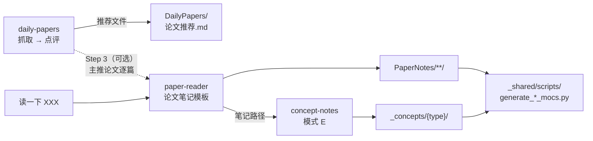
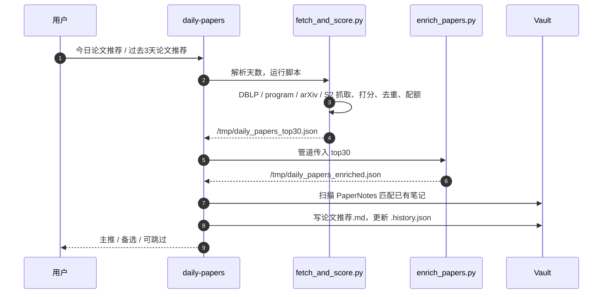

# arch-reading-skills 架构

本文讲清两条主线和两套模板：

- **每日推荐**（`skills/daily-papers/`）：论文怎么被抓取、打分、点评，以及可选的批量精读。
- **概念库**（`skills/concept-notes/`）：概念笔记怎么生成、分类、维护，以及它和论文笔记的分工。
- **论文笔记模板**（`skills/paper-reader/assets/paper-note-template.md`）和 **概念笔记模板**（`skills/concept-notes/assets/concept-note-template.md`）。

安装、触发词和其他 skill（book-reader、repo-reader、repo-learning-path）见 `README.md`。本文所有路径都相对仓库根目录。

## 1. 总览

| Skill | 职责 | 产物 |
|---|---|---|
| `daily-papers` | 抓取 → 点评 → 可选批量精读 | `DailyPapers/YYYY-MM-DD-论文推荐.md` |
| `paper-reader` | 读一篇论文，按论文模板写笔记 | `PaperNotes/**/{MethodName}.md` |
| `concept-notes` | 概念的唯一归属：分类、模板、生成、重写、自检；刷新目录页 | `PaperNotes/_concepts/{concept_type}/*.md`、`_index_*.md` |
| `verilog-diagram` | 把 Verilog / 论文画成可编辑的 draw.io 图；也是 `_shared/references/diagram-rules.md` 里流水线分级架构图那条路线 | `.drawio` + PNG / SVG |
| `paper-to-zotero` | 题目 / DOI / 链接 → Zotero 条目（带 PDF、放进叶子分类），经 Zotero 10 本地 API 写入；入库后可接 paper-reader | Zotero 条目 |
| `kepu-research-doc` | 中文科普 / 调研文档（坐标轴、术语速查、配图、封面、宣传简介、私人映射） | `<主题>.md` + PDF |
| `gpt-image-bridge` | 经 `codex` CLI 调 GPT Image 生成图片，生成前逐张征得同意；verilog-diagram 的可选构图草图来自它 | PNG |
| `_shared`（不是 skill） | 共享配置、目录页生成、转义检查、venue 标签、画图规则 | — |



分工的原则：**谁的模板归谁管**。论文笔记的结构只在 paper-reader 里定义，概念笔记的结构只在 concept-notes 里定义；daily-papers 不写任何笔记，只调用 paper-reader。

## 2. 每日推荐：`daily-papers`

### 2.1 三步流水线

三步都写在 `skills/daily-papers/SKILL.md` 里，共用一个 Step 0（读配置）。

| 步骤 | 触发 | 输入 | 输出 |
|---|---|---|---|
| Step 1 抓取 | `今日论文推荐`、`跑一下论文抓取` | 配置里的关键词、venue、天数 | `/tmp/daily_papers_top30.json` → `/tmp/daily_papers_enriched.json` |
| Step 2 点评 | 紧接 Step 1，或 `跑一下论文点评` | `/tmp/daily_papers_enriched.json`、已有笔记库 | `{DailyPapers}/YYYY-MM-DD-论文推荐.md`、`.history.json` |
| Step 3 笔记（可选） | `跑一下论文笔记`、`批量笔记` | 当天推荐文件里的主推论文 | 论文笔记、概念笔记、回填到推荐文件的 `📒 笔记` 链接 |

默认只跑 Step 1 + 2。Step 3 会生成大量长笔记，是否精读由用户决定。



### 2.2 Step 1：抓取与打分

```bash
python3 skills/daily-papers/scripts/fetch_and_score.py --days 3 > /tmp/daily_papers_top30.json
cat /tmp/daily_papers_top30.json | python3 skills/daily-papers/scripts/enrich_papers.py /tmp/daily_papers_enriched.json
```

`fetch_and_score.py` 的流程：

1. 抓候选：`fetch_dblp_papers`（DBLP proceedings / journal）、`fetch_conference_program_papers`（近期会议 program 页）、`fetch_arxiv_papers`；候选不足时 `fetch_semantic_scholar_papers` 补充。
2. 打分：`score_paper` 按配置打分（见下表）。
3. 合并去重：`merge_and_dedup` 合并同一篇论文的多个来源；`build_history_index` 读 `.history.json` 去掉已推荐过的；候选不足时 `load_fallback_ids` 允许回填并标 `is_re_recommend`。
4. 排序选取：`apply_age_decay` 压低旧会议论文，`select_with_quota` 限制非 arXiv 来源占比，取 `top_n`。

| 打分信号 | 行为 |
|---|---|
| `keywords` 命中标题 / 摘要 | 每个 +3 / +1 |
| `domain_boost_keywords` 命中 1 个 / 2-3 个 / 4 个及以上 | +1 / +2 / +4 |
| `focus_phrases` 命中（重点方向短语，如 `multicore`、`cache hierarchy`） | 每个 +1 |
| 以上主题分为 0 | 直接 0 分，不再加 venue 分（程序页里的日程条目、主题不对的顶会论文都进不来） |
| venue 的 CCF 等级（`venue_rank_scores`，默认 A / B / C = 3 / 2 / 1） | 加一次；arXiv、workshop、CCF 目录外的 venue 不加 |
| `negative_keywords` 命中标题 | 直接 -999 排除；只命中摘要不排除 |

venue 先经 `skills/_shared/scripts/venue_label.py` 归一成缩写，再由 `skills/_shared/scripts/ccf_rank.py` 查 `ccf_ranks.json`（取自 CCFrank4dblp，CCF 2022 版，615 个缩写）。默认配置按“体系结构为主、LLM 系统为辅”设计：关键词和重点短语来自作者 Zotero 里 Computer Architecture / LLM Infrastructure 两个分类的标题与摘要；`min_score` = 3。

`enrich_papers.py` 并发补全作者、机构（委托 `extract_affiliations.py`）、章节标题、图表 caption、首图、`method_name(s)`、`method_summary`，并给出点评要用的三个信号：`has_hardware_eval`、`has_end_to_end_eval`、`has_real_workload`（如 `extract_has_hardware_eval`）。

### 2.3 Step 2：点评与分流

点评只基于富化数据、摘要、章节标题和表格标题，不编造论文里没有的缺陷。分流规则：

| 等级 | 条件 |
|---|---|
| 🔥 主推（1–2 篇） | 主题高度相关，且 `has_hardware_eval=true` |
| 👀 备选（最多 3 篇） | 方向相关但证据不够；做 serving 却 `has_end_to_end_eval=false` 的最多到这里 |
| 💤 可跳过 | 只有模型花活、没有系统贡献 |

同分时 `has_real_workload=true` 优先。与 LLM 体系结构 / 网络通信 / 存储内存无关的论文直接排除，列在文末“被排除的论文”。每篇只写 2 句：解决什么问题、为什么值得看（或为什么只配备选）。

推荐文件结构：`# 🔪 今日锐评` → `## 分流表` → `## 主推（1-2 篇）` → `## 备选（最多 3 篇）`。保存后更新 `.history.json`（保留 30 天）。

### 2.4 Step 3：批量笔记

1. **补概念**：从推荐文件的 `[[…]]`、富化数据的 `method_names` 和 seed list 命中词收集候选，交给 `concept-notes` 模式 A。
2. **生成笔记**：对每篇 `🔥 主推` 调用 `paper-reader`（它会再调用 `concept-notes` 模式 E）。已有笔记少于 100 行、或缺 `## 批判性思考` / `## 复现` / `## 关联笔记` / `## 速查卡片` 的视为骨架，重新生成。
3. **质量门**：每篇 ≥ 120 行、≥ 2 处 LaTeX、≥ 1 张图、四个必需章节都在、没有独立的 `## 关键公式` / `## 关键图表`；不达标就删掉重生成。禁止手写简化笔记代替 paper-reader。
4. **回填**：在推荐文件每篇论文的 `- **来源**:` 行后插入 `- 📒 **笔记**: [[笔记名]]`。
5. **刷新目录页**：`AUTO_REFRESH_INDEXES=true` 时运行 `skills/_shared/scripts/generate_concept_mocs.py` 和 `generate_paper_mocs.py`。

### 2.5 中间文件

| 文件 | 写入方 | 读取方 |
|---|---|---|
| `/tmp/daily_papers_top30.json` | `fetch_and_score.py` | `enrich_papers.py`（stdin） |
| `/tmp/daily_papers_enriched.json` | `enrich_papers.py` | Step 2、Step 3 |
| `DailyPapers/.history.json` | Step 2（保留 30 天） | `build_history_index` 历史去重 |

## 3. 概念库：`concept-notes`

### 3.1 文件归属

概念相关的规则和脚本只在 `skills/concept-notes/` 里，paper-reader 和 daily-papers 只引用，不复制：

| 文件 | 内容 |
|---|---|
| `skills/concept-notes/SKILL.md` | 五种模式的流程、过滤规则、git 自动化 |
| `skills/concept-notes/assets/concept-note-template.md` | **概念笔记模板**：frontmatter + 8 个统一段 + 差异化段占位 |
| `skills/concept-notes/references/concept-categories.md` | 8 类 `concept_type`、判定原则、seed list、长度预算、直观例子写作规则、差异化段表 |
| `skills/concept-notes/scripts/scan_missing_concepts.py` | 扫描“有 `[[wikilink]]` 但没有概念笔记”的术语，可加 seed list |
| `skills/concept-notes/scripts/regenerate_concepts.py` | 按增强模板批量重写旧概念（prompt → 外部 LLM → diff → install） |
| `skills/concept-notes/scripts/check_concept_length.py` | 概念长度自检 |

目录页脚本（`generate_concept_mocs.py`、`generate_paper_mocs.py`、`moc_builder.py`、`clean_old_mocs.py`）留在 `skills/_shared/scripts/`，因为论文目录页也用它们。

### 3.2 五种模式

| 模式 | 入口 | 做什么 |
|---|---|---|
| A 生成概念 | `生成概念 XXX`；daily-papers Step 3 | 过滤 → 查重（递归，含 `aliases`）→ 按类型归到子目录、按模板创建 → 长度自检 |
| B 扫描缺失 | `补全缺失的概念` | `scan_missing_concepts.py` 列候选（按引用次数排序）→ 用户确认 → 模式 A |
| C 批量重写 | `重新生成概念笔记` | `regenerate_concepts.py` 的 dry-run / prompts / apply / diff / install；install 前必须征得同意 |
| D 刷新目录页 | `更新索引`、`刷新MOC` | 跑两个 MOC 脚本；`clean_old_mocs.py` 清旧命名目录页需确认 |
| E 论文附带 | paper-reader 写完一篇笔记后 | 收集本篇 `[[概念]]` 和未加链接的 seed 词 → 模式 A；已有概念只追加代表工作；返回新概念路径给 paper-reader 做链接复查 |

A / B / C / E 写完概念后，`AUTO_REFRESH_INDEXES=true` 时接着跑 D。

```bash
python3 skills/concept-notes/scripts/scan_missing_concepts.py --with-seed --dry-run
python3 skills/concept-notes/scripts/regenerate_concepts.py --dry-run --only "KV Cache"
python3 skills/concept-notes/scripts/check_concept_length.py "<概念笔记>"
python3 skills/_shared/scripts/generate_concept_mocs.py
python3 skills/_shared/scripts/generate_paper_mocs.py
```

### 3.3 过滤规则

- 宁可多建，不要误杀真正的 systems concept；不确定就创建，后续再 review。
- seed list 里的基石术语（RDMA、NVLink、PCIe、NUMA、HBM、CXL、AllReduce、NCCL、CUDA 等）必须保留。
- 数据集、benchmark suite、仿真器、纯实验环境不建概念。
- 论文方法名分三档：论文首创且只在本论文实验 → 建概念并加 `status/paper-specific`；论文具名实现但前人工作 / 被多篇当 baseline → 通用概念；完全是前人工作、本文只是引用 → 不独立建概念。至少 2 篇作者无重叠的独立工作使用后才升格。

### 3.4 8 类 `concept_type`

按概念本身的性质分类，**不**按论文研究领域分类；子目录名就是类型名。

| 类型 | 是什么 | 例子 |
|---|---|---|
| `data-structure` | 数据格式 / 表示 / 结构 | KV Cache、BFloat16、Radix Tree |
| `algorithm` | 脱离系统也成立的计算逻辑 | Huffman Coding、AllReduce |
| `mechanism` | 绑定系统上下文的运行时策略 | PagedAttention、Kernel Fusion |
| `architecture` | 宏观系统架构 / 服务模式 | LLM Serving、Parameter Server |
| `hardware` | 硬件部件 / 计算单元 / 物理互联 | Tensor Core、NVLink、HBM |
| `software-abstraction` | OS / 框架层接口与协议 | CUDA、NCCL、vLLM Engine |
| `metric` | 评估指标 / 测量口径 | TTFT、Tail Latency、MPKI |
| `theory-model` | 性能模型与数学基础 | Roofline Model、Little's Law |

`algorithm` 和 `mechanism` 的分界：脱离系统还成立就是 algorithm，否则是 mechanism。

### 3.5 概念笔记模板

模板骨架在 `skills/concept-notes/assets/concept-note-template.md`，和论文模板一样放在 `assets/`；写法规则在 `references/concept-categories.md`。每篇概念笔记 = 8 个统一段 + 1 个按类型加的差异化段。frontmatter 是 `type: concept`、`aliases`、`concept_type`，paper-specific 时加 `tags: [status/paper-specific]`。

| 统一段 | 写什么 |
|---|---|
| `## 定义` | 一句话 what，不写 why |
| `## 动机与痛点` | 为什么出现、解决什么瓶颈、比之前好在哪 |
| `## 直观例子` | 用一个具体场景分步推导，可配图 |
| `## 核心要点` | 3–5 条，每条讲原理 |
| `## 边界与对比` | 不适用的情况、和最容易混淆的近邻概念的差别 |
| `## 代表工作与具体用法` | 哪些论文怎么用它、用出什么效果 |
| `## 相关概念` | 组成 / 替代 / 协作 / 前置关系 |
| `## 学习索引` | 入门论文、教科书章节、实现；找不到证据就整段写 `TODO`，不编造 |

| 类型 | 差异化段 |
|---|---|
| `data-structure` | `## 内存视图 / 字段布局` |
| `algorithm` | `## 步骤` + `## 复杂度` |
| `mechanism` | `## 状态与触发条件` + `## 关键参数` |
| `architecture` | `## 组件与接口`（必须有组件图，不允许 ASCII） |
| `hardware` | `## 接口与典型参数` |
| `software-abstraction` | `## API 与生命周期` |
| `metric` | `## 测量方法` |
| `theory-model` | `## 假设与失效边界` |

长度分两项计：`直观例子` ≤ 100 行，其他段合计 ≤ 90 行；frontmatter 不计，图的嵌入行按 1 行计，退回的 Mermaid 源码不计。由 `check_concept_length.py` 检查。

## 4. 论文笔记模板：`paper-reader`

### 4.1 文件与 frontmatter

模板本体是 `skills/paper-reader/assets/paper-note-template.md`。文件名只用主方法名 / 系统名 `{MethodName}.md`；有 Zotero collection 时保存到 `{PaperNotes}/{collection_path}/`，否则到 `{PaperNotes}/_inbox/`。

frontmatter：`title`、`method_name`、`authors`、`year`、`venue`（不带年份的缩写，如 `MICRO`）、`tags`、`zotero_item_id`、`zotero_collection`、`doi`、`arxiv_id`、`image_source`（`online` / `mixed` / `local`）、`created`。去重按 `zotero_item_id → doi → arxiv_id → 标题 → 文件名`。

第一行标题是 `# 论文笔记：{Title} ({VenueLabel})`，`VenueLabel` 形如 `MICRO'25`，由 `skills/paper-reader/scripts/zotero_helper.py resolve` 或 `skills/_shared/scripts/venue_label.py` 给出，给不出时连括号省略。

### 4.2 章节结构

章节顺序是一条论证链：先说问题，再给证据，再讲设计，最后评估。

| 章节 | 要点 |
|---|---|
| `## 元信息` | 机构、日期、项目主页、主对比基线 |
| `## 一句话总结` / `## 这篇论文为什么重要` | 只写结论，不放图表和数字 |
| `## 问题定义` | 系统范围与层次、要解决的问题、现有方法与设计空间（只有这里允许定义性公式） |
| `## 动机实验与核心 Insights` | 每个 `### Insight N` 用证据支撑，以 **设计启发** 收尾并链接到机制；证据只在这里出现一次 |
| `## 核心贡献` | 回应前面的 Insight，只引用已给出的数字 |
| `## 系统设计总览` | `### 系统架构`（论文原图优先，否则自画一张，二选一）+ 组件表；`### 执行流` 编号走读；`### 优化目标与度量口径` |
| `## 关键机制拆解` | 所有 `###` 都是 `### 机制N：…`；内部用 `#### 设计动机 / 机制说明 / 实现要点 / 参数与权衡` |
| `## 实验设置` | Workload、Baselines、评测指标、`### 模拟器与微架构参数`（必须有一张测试系统连接关系图） |
| `## 核心结果` | 主结果、消融 / 敏感性、结果解读 |
| `## Overhead 与兼容性` | 先放 `### 实现改动清单`，再写面积 / 延时 / 资源开销和平台、ISA / OS 侵入性 |
| `## 批判性思考` | 只有 `优点` / `局限、假设与失效场景` / `潜在改进方向` 三节，每条局限都写 **失效场景** |
| `## 经验与可迁移启示` | 可迁移设计原则、写 related work 时值得引用的点 |
| `## 复现` | 环境与依赖、关键配置、`### 复现核查表`（三列表格）、风险与缺口 |
| `## 关联笔记` | 分 方法 / 理论与指标 / 系统与硬件 三组 |
| `## 相关工作定位` | 表头 `论文 / 外部链接 / 关系 / 差异` |
| `## 速查卡片` | `[!summary]` callout：核心 / 方法 / 结果 / 适用场景 / 未来工作 / 引用建议 |

### 4.3 写作硬约束

- 论文里所有 Figure、公式、Table 都要出现，并嵌在对应叙事小节里；不设独立的 `## 关键公式` / `## 关键图表`。
- 图片标题写进图片引用的 alt（``），不要把单张图或单个公式提升成 `###` / `####` 大纲标题。
- 锚点：Figure 行尾 `^figN`，表格后单独一行 `^tab-…`，核心贡献 `^contrib-N`，自画图 `^diag-…`；正文引用一律写 `[[#^id|…]]` 跳转链接。
- 技术术语首次出现加 `[[概念]]`；seed list 里的词首次出现必须写成 `[[概念名]]`。
- 正文禁止 Obsidian task 语法（`- [ ]` / `- [x]`）。
- 图片优先外链 arXiv HTML；本地 PDF 裁图存到笔记同目录 `00_assets/<note-name>_<原图片名>`。

### 4.4 自画图路线

规则在 `skills/_shared/references/diagram-rules.md`，论文原图不在其中（有原图就直接嵌入）。

| 图的类型 | 默认路线 | 不可用时 |
|---|---|---|
| 流程、模块结构、系统架构、评测平台、概念组件图 | diagram-design 画 HTML，导出 PNG 到 `00_assets/` 嵌入 | 退回 Mermaid（遵守 `skills/_shared/references/mermaid-rules.md`） |
| 多角色时序 / 协议交互、时间线 / 甘特 | draw.io | diagram-design → Mermaid |
| 流水线分级架构图、硬件数据通路 | verilog-diagram 的 `arch2drawio.py` | diagram-design → Mermaid |
| 矩阵分块、内存布局等空间结构 | matplotlib | — |

diagram-design 的 PNG 导出依赖 Playwright；缺少时直接走 Mermaid 退回路线，并在汇报里写明。

### 4.5 写完后的检查

```bash
python3 skills/paper-reader/scripts/check_note_links.py "<笔记>" "<新概念>" ...
python3 skills/_shared/scripts/md_escape_check.py "<笔记>"
python3 skills/daily-papers/scripts/download_note_images.py "<笔记>"
```

`check_note_links.py` 查断链、重复锚点、找不到的 `[[概念]]` / 嵌入文件、表格内未转义的 `|`，以及漏写链接的裸 “Figure N / 机制N”；要修到每个文件都输出 `OK`。`md_escape_check.py` 查正文里会被 Obsidian 误解析的符号：数组下标 `C[i]`、字面量 `$`、误触发的 `#标签`、尖括号占位符 `<note-name>`（`<br>` 等真 HTML 保留）、词中的 `*`，以及表格行里代码和 wikilink 中没转义的 `|`；加 `--fix` 原地转义。`==高亮==`、`~~删除线~~` 在 vault 里都是有意使用，不处理。`download_note_images.py` 把不可达的外链图片下载到 `00_assets/` 并把 `image_source` 改成 `mixed`。

### 4.6 改模板时要同步的地方

论文模板的结构写在三处：模板本体、`skills/paper-reader/SKILL.md` 的质量规则与自检、`tests/test_systems_template.py` 的断言。只改模板不改 SKILL 自检，agent 会按旧自检项检查新结构；测试断言的是规则文本，不是生成物。概念模板同理，写在 `skills/concept-notes/assets/concept-note-template.md`（本体）、`concept-categories.md` 的规则、`skills/concept-notes/SKILL.md` 和 `regenerate_concepts.py` 的 prompt 里。

## 5. 配置

所有 skill 先读 `skills/_shared/user-config.json`，再用个人配置覆盖：`ARCH_READING_CONFIG` 指向的文件，否则 `~/.config/arch-reading-skills/user-config.json`，两者都没有时兜底读旧的 `skills/_shared/user-config.local.json`（三者只取一个）。个人配置只有这一个文件，放在 skill 目录外，`npx skills update` 覆盖 skill 目录时不会丢；repo-reader 也从这里取 `repo_reader.guide_dir`（由 agent 按 SKILL.md 读取）；Python 脚本通过 `skills/_shared/scripts/user_config.py` 读同一份配置。

| 配置 | 作用 |
|---|---|
| `paths.*` | vault、论文笔记目录、每日推荐目录、概念库目录、Zotero DB / storage |
| `daily_papers.keywords` / `domain_boost_keywords` / `negative_keywords` / `focus_phrases` | 打分用的关键词、加分词、排除词、重点方向短语 |
| `daily_papers.venue_rank_scores` | CCF A / B / C 各加几分，默认 3 / 2 / 1 |
| `daily_papers.arxiv_categories` / `min_score` / `top_n` | arXiv 查询范围、最低分、候选上限 |
| `automation.auto_refresh_indexes` | 写完笔记 / 概念后是否自动刷新目录页（默认开） |
| `automation.git_commit` / `git_push` | 是否提交 vault（默认关；push 只在 commit 开启时生效） |
| `mocs.filename_prefix` | 目录页文件名前缀，常用 `_index_` |
| `repo_reader.guide_dir` | repo-reader 写架构文档的 vault 目录 |
| `paper_to_zotero.collection_root` / `collection_hints` | paper-to-zotero 挑叶子分类的 Zotero 根分类（默认 `Computer Architecture`，空 = 整个库；库里没有这个分类时停下并提示怎么配置）和各叶子的说明（默认 18 条体系结构分类，作参考）；`zotero_add.py collections` 把说明印在叶子旁 |

## 6. 目录约定

每个 skill 目录内按职责分三类子目录：

| 目录 | 放什么 | 判断标准 |
|---|---|---|
| `scripts/` | 可执行代码 | `python3 …` 能跑的东西 |
| `references/` | agent 读进上下文的规则、指南、分类标准 | 读完影响 agent 怎么做 |
| `assets/` | 填充或复制到输出里的模板 | 内容会出现在生成物里 |

`tests/test_repo_layout.py` 检查 `.py` 只在 `scripts/` 下（生成的 `<skill>/_shared/scripts/` 也算），并解析所有 Markdown 里的 `python3 …py` 路径。移动脚本时要同步改它们插入 `sys.path` 的路径和测试里的模块路径。

### 6.1 `_shared` 怎么分发

`npx skills add` 只复制单个 skill 文件夹，`_shared` 不会跟着装；仓库里也不能放指向 `_shared` 的软链接，因为 skills CLI 按 skill 文件夹的 git tree hash 判断是否更新，只改 `_shared` 时被链接方的 hash 不变，`npx skills update` 永远不会触发。所以：

- `skills/_shared` 是唯一源，没有 SKILL.md。`scripts/sync_shared.py` 把它（外加 `concept-notes/references/concept-categories.md`）复制进 `skills/{paper-reader,concept-notes,daily-papers}/_shared/`；`repo-reader` 只带 `md_escape_check.py` 和 `mermaid-rules.md`，`book-reader` 只带 `mermaid-rules.md`，`paper-to-zotero` 只带 `user_config.py` 和 `user-config.json`，`verilog-diagram`、`gpt-image-bridge`、`kepu-research-doc`、`repo-learning-path` 不用 `_shared`。副本提交进 git，不手改。
- 带副本的 skill 的文档只写 skill 目录内的相对路径 `_shared/…`，不写 `../_shared` 或兄弟 skill 的路径；`test_vendored_skills_reference_only_their_own_shared_copy` 检查这一点。
- 脚本源优先：`_find_shared_scripts()` 发现 `parents[3]/scripts/sync_shared.py` 存在（即在仓库或 plugin 缓存的整仓副本里）时用 `skills/_shared/scripts`，否则用自己的 `_shared/scripts` 副本。clone 下改 `skills/_shared` 立即生效；agent 按 SKILL.md 直接运行的 `_shared/scripts/*.py` 仍是副本，改完要跑一次 sync。
- 防漂移：`.githooks/pre-commit`（`git config core.hooksPath .githooks` 启用）和 `.github/workflows/test.yml` 都跑 `sync_shared.py --check`，`tests/test_sync_shared.py` 也跑。
- 三种安装：`npx skills add BeenLi/arch-reading-skills -g -a claude-code`；`/plugin marketplace add BeenLi/arch-reading-skills`（`.claude-plugin/marketplace.json`，`source: "./"`、`strict: false`，不列 skills，默认扫 `skills/`）；git clone + 软链接（本机开发用，只链接 10 个 skill，不链接 `_shared`）。

## 7. 测试

```bash
python3 -m pytest tests/ -q
```

| 测试 | 守护什么 |
|---|---|
| `tests/test_daily_papers_theme.py` | 每日推荐的主题、分流规则、默认不精读 |
| `tests/test_fetch_and_score.py`、`tests/test_enrich_papers.py` | 抓取、打分、富化行为 |
| `tests/test_systems_template.py` | 论文模板章节与锚点、概念规则只在 concept-notes、画图路线 |
| `tests/test_scan_missing_concepts.py`、`tests/test_regenerate_concepts.py`、`tests/test_check_concept_length.py` | 概念脚本 |
| `tests/test_generate_paper_mocs.py` | 目录页生成 |
| `tests/test_repo_layout.py` | 目录约定和文档里的脚本路径 |
| `tests/test_check_note_links.py` | 论文笔记链接复查：标题 / 块链接、wikilink、嵌入、裸 Figure / Table 引用 |
| `tests/test_md_escape_check.py` | Obsidian 转义检查和 `--fix` 的幂等性 |
| `tests/test_download_note_images.py` | 笔记图片本地化 |
| `tests/test_ccf_rank.py`、`tests/test_venue_label.py` | CCF 等级查询、venue 缩写和标题标签 |
| `tests/test_zotero_helper.py`、`tests/test_zotero_helper_writes.py`、`tests/test_zotero_local_api.py` | Zotero 只读解析、经本地 API 的分类调整 / 字段修改 / 回收站、版本冲突 |
| `tests/test_paper_to_zotero.py` | paper-to-zotero 的分类树与叶子说明、查重输出的分类路径和 PDF 路径 |
| `tests/test_repo_reader_check_doc.py`、`tests/test_repo_reader_repo_facts.py` | repo-reader 的 12 节契约检查、仓库事实采集 |
| `tests/test_repo_learning_path_check_links.py` | repo-learning-path 的链接检查：相对链接和图片存在、`#L` 行号不越界、代码块里的链接不算 |
| `tests/test_user_config.py` | 配置叠加顺序、`ARCH_READING_CONFIG` 的互斥规则 |

## 附录：Obsidian 硬链接

本文同时出现在 Obsidian vault 里：

```text
<vault>/002-notes/001 使用指南/arch-reading-skills-架构和使用文档.md
```

它是 `<repo>/ARCHITECTURE.md` 的硬链接（`<vault>`、`<repo>` 按本机实际路径代入）。检查：

```bash
stat -f "%d %i %l %N" <repo>/ARCHITECTURE.md \
  "<vault>/002-notes/001 使用指南/arch-reading-skills-架构和使用文档.md"
```

两行的 device 和 inode 必须一致，link count 至少为 2。`git checkout`、`git restore`、rebase、iCloud 同步或编辑器“写新文件再替换”都可能打断硬链接；inode 不一致时，备份 Obsidian 侧文件后删除它，再用 `ln` 重建。修改本文时原地覆盖写入，不要先写临时文件再改名。
