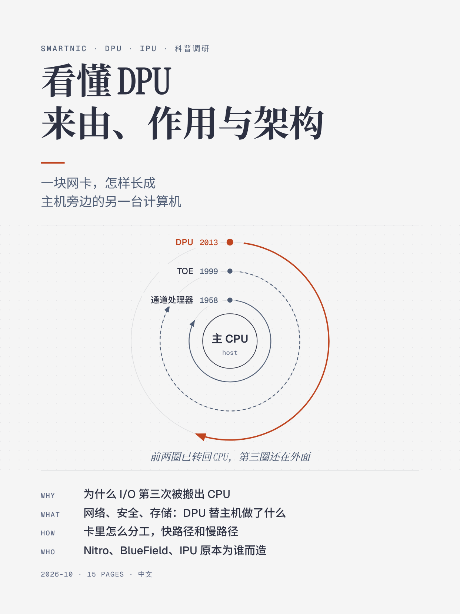

# 《看懂 DPU：来由、作用与架构》简介

可以了解到：

1. DPU 兴起的两个原因：网卡带宽和 CPU 增速之间的差距越拉越大，CPU无法满足高速IO的性能需求；云上的 CPU 有大量的客户租用买单，而网络、存储和安全等公共基础设施会占用可以出租的CPU资源。这三者也是DPU的核心功能。

2. 内核协议栈、DPDK、XDP、卸载网卡四种网络栈的对照。

3. I/O 卸载的历史：从 1958 年的通道处理器讲到今天的 DPU。

4. DPU 内部结构、软件栈，以及当前最具有竞争力的产品分析

**适合：** 对硬件为什么长成这样感到好奇的软件、系统和网络工程师，不需要芯片背景。
