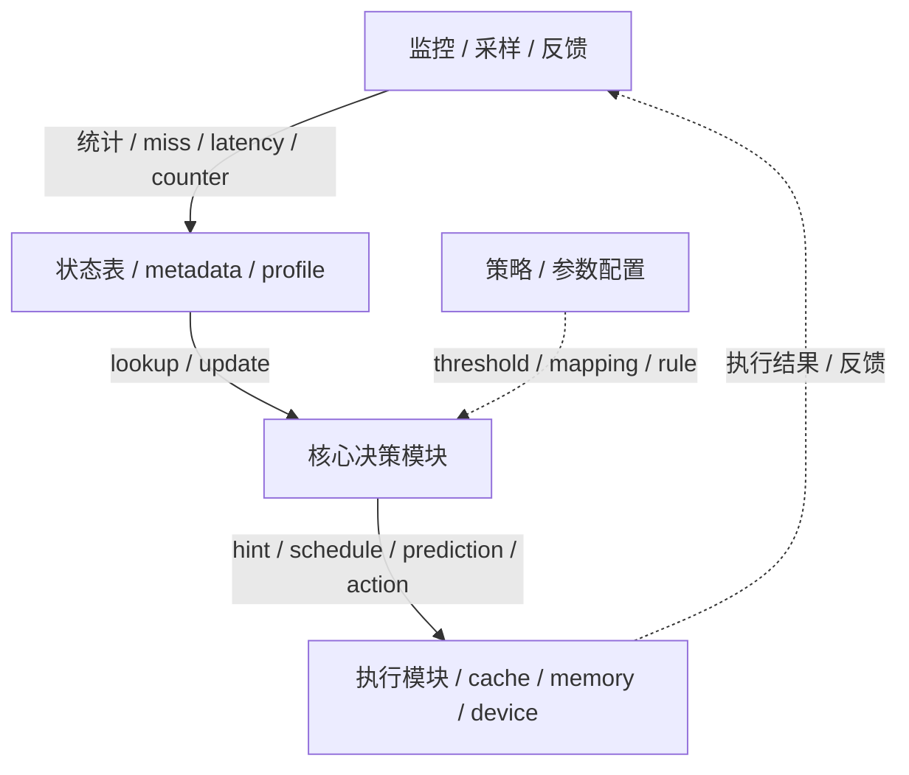
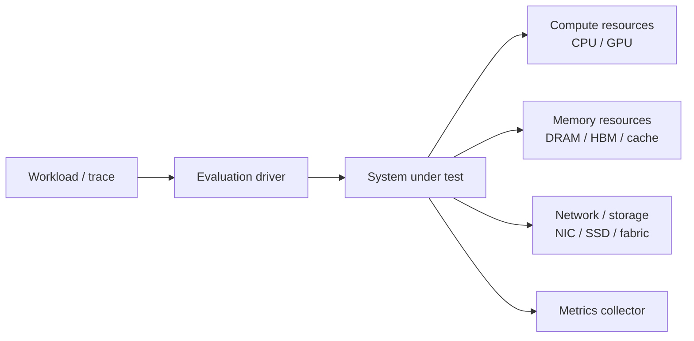

<!--
写作约束：
1. 不要单独设置“关键公式”或“关键图表”章节。
2. 公式和图表必须嵌入对应叙事位置：动机实验与核心 Insights、系统设计总览、关键机制拆解、实验设置、核心结果、Overhead 与兼容性；`### 现有方法与设计空间` 只允许定义性公式，不放图表。
3. 每次出现图或公式，都要用自然段说明它在论文论证链中的位置、关键趋势或定量证据，以及它支撑的设计或结论；不要只堆素材，也不要保留模板字段名。
4. “批判性思考”的 `### 局限、假设与失效场景` 把每条局限或隐含假设和它的失效场景写在同一条里：先写局限 / 假设及依据，再写 **失效场景**（在什么条件下失效、后果是什么）；不另设单独的失效场景子节。
5. 保留“关联笔记”和“速查卡片”，方便 Obsidian 中后续导航和回顾。
6. Obsidian 大纲层级只给语义结构使用，不要把普通图片写成 H3 或独立加粗标题；图片标题写进图片引用的题注/alt 文本，如 ``。
7. `## 关键机制拆解` 到下一个 `##` 之间，所有 `###` 标题必须是 `### 机制N：{机制名}`；机制内部只有按论文结构或 Agent 理解提炼出的语义子小节才可以使用 `####`，例如设计动机、机制流程、算法流程、pipeline stage、实现要点、参数权衡。普通单张 Figure / Table / 单个公式不要单独写成 `####` 小节，只能嵌入对应语义小节的自然段。
8. `相关工作定位` 中：
   - `论文` 列优先写 `[[笔记名]]`，没有内部笔记时写纯标题。
   - `外部链接` 列写 `[arXiv](...)` / `[DOI](...)` / `[Paper](...)`，没有就留空。
9. `## 这篇论文为什么重要` 和 `## 问题定义` 只写结论：不放图、表、数字；公式只允许出现在 `### 现有方法与设计空间` 作为定义。所有定量证据只在 `## 动机实验与核心 Insights` 出现一次。`## 核心贡献` 放在 Insights 之后、`## 系统设计总览` 之前：每条贡献回应前面的 Insight，需要数字时只引用 Insights 里已经给出的证据，不引入新数字。
10. 每个 `### Insight N：…` 以 **设计启发** 收尾并链接到对应机制；没有实验证据、靠作者推理得出的 insight 标注"作者论证"而不是"实验"。纯 characterization 论文允许所有 insight 来自实验、没有机制可映射。
11. `### 系统架构` 的结构图：论文有总体架构图时直接嵌入原图并挂 `^figN`；没有、或原图看不出模块边界与数据流时，才按 `../../_shared/references/diagram-rules.md` 自画一张（锚点 `^diag-arch`）。二选一，不并存。`### 执行流` 用编号步骤走读；满足任一条件时在编号步骤前加一张执行流全局图（锚点 `^diag-flow`）：执行流 ≥ 5 步（按编号列表条数计，一步对应一次模块间交接）；≥ 3 个角色或组件且有反馈闭环或回到上游模块或自身的重试 / 迭代循环（单纯的请求-响应返回不算）；有分支、并行或异步路径；系统架构图里模块之间没有带方向的箭头或步骤编号。这张图讲“怎么动”，步骤编号与列表一致，不要重画系统架构图的模块结构；四个条件都不满足就不画。
12. 锚点与跳转：Figure 行尾 ` ^figN`（子图 `^fig8a`）；表格结束后空一行、单独一行 `^tab-…`、再空一行；公式锚点挂在公式下方解释段末尾；Insight / 机制 / 章节用标题链接 `[[#标题|短名]]`，标题部分必须与目标标题逐字一致；核心贡献条目末尾 ` ^contrib-N`。id 只用小写字母、数字、连字符，全文唯一。正文提到 Figure / Table / 公式 / Insight / 机制 / 贡献时一律写跳转链接，不写裸文字。表格单元格里的 wikilink 别名分隔符写成 `\|`，否则会切坏表格。
13. 笔记写完、概念库补齐之后，在 paper-reader skill 目录下对论文笔记和本次新建的概念笔记一起运行 `scripts/check_note_links.py <笔记> <新建的概念笔记> ...`，复查所有跳转链接、wikilink 和嵌入，逐条修到每个文件都输出 OK 为止。
-->

# 论文笔记：{Title}

## 元信息

| 项目 | 内容 |
|------|------|
| 标题 | {Title} |
| 方法名 | {MethodName} |
| 作者 | {Authors} |
| 机构 | {Affiliations} |
| 发表 | {Venue}, {Year} |
| 主对比基线 | [[{baseline_paper}]] / {other_baselines} |
| 链接 | [arXiv]({arxiv_url}) / [Paper]({paper_url}) / [Code]({code_url}) |

---

## 一句话总结

> {用一句话概括这篇论文最核心的系统价值，不超过 50 字}

---

## 这篇论文为什么重要

> 不读正文也能带走的三句话。只写结论，不放图、表、数字；证据留给 `## 动机实验与核心 Insights`。

- **系统范围与问题**: {在栈的哪一层、边界内外是什么、本文回答的是哪个问题，一句话}
- **最关键的 insight**: {作者最值得记住的那一个设计洞察，一句话}
- **实际价值**: {为什么这件事对部署、性能或系统设计有意义，一句话}

---

## 问题定义

### 系统范围与层次

{论文把系统边界画在哪里：栈的哪一层（硬件微架构 / runtime / 调度器 / 网络协议 / 存储 …）、边界内外各是什么、哪些东西当作给定不动（模型、硬件、workload 分布）、输入输出是什么。读者据此判断“这篇论文和我的问题是否在同一层”。}

### 要解决的问题

{目标 workload 或 deployment 场景、优化对象（延迟 / 吞吐 / 面积 / 带宽 …）、约束条件，以及瓶颈落在哪一类资源（算力、内存、存储、网络、调度、运行时还是框架兼容性）；一句定性判断，不带数字。}

**本文回答的问题是**：{一句话}

### 现有方法与设计空间

{按类别而不是逐篇写前人方法：每一类优化什么轴、隐含什么假设、卡在哪。只做定性判断；定量失效证据写在 `## 动机实验与核心 Insights`，逐篇对照和链接写在文末 `## 相关工作定位`。}

1. **{方法类别1}**: {优化轴 / 隐含假设 / 卡点}
2. **{方法类别2}**: {优化轴 / 隐含假设 / 卡点}
3. **{方法类别3}**: {优化轴 / 隐含假设 / 卡点}

$$
...
$$

{只有在需要给出前人方法的定义性公式（例如 baseline 的分解式或度量口径）时才保留上面的公式块，并用自然段说明它定义的对象和主要变量；不要在这里放实验数字。} ^eq-baseline

---

## 动机实验与核心 Insights

> 每个 Insight 一个小节，内部顺序固定：证据 → 解读 → 设计启发。这里是定量证据在全文唯一出现的位置。没有实验、靠作者推理得出的 insight 也可以列，但在解读段开头标注“作者论证”而不是“实验”。数量 2-4 个。

### Insight 1：{一句话结论}

 ^fig2

{用 2-4 句自然段解读：先说明这组 characterization 在动机论证链中的作用，再提炼关键趋势或定量证据（必要时点明覆盖的 workload / 场景），最后说明它为什么成立。}

**设计启发**：{这个 insight 导向什么设计原则} → [[#机制1：{名称}|机制1]]

### Insight 2：{一句话结论}

 ^fig3

$$
...
$$

{解读自然段：现象、定量证据、它支撑的设计或结论；若有公式，用自然段解释它建模的系统现象和主要变量的角色，锚点挂在本段末尾。} ^eq-motivation

**设计启发**：{这个 insight 导向什么设计原则} → [[#机制2：{名称}|机制2]]

### 设计原则到机制的映射

| 设计原则 | 来自 | 落到 |
|---|---|---|
| {原则一句话} | [[#Insight 1：{一句话结论}\|Insight 1]] | [[#机制1：{名称}\|机制1]] |
| {原则一句话} | [[#Insight 2：{一句话结论}\|Insight 2]] | [[#机制2：{名称}\|机制2]] |

^tab-principles

---

## 核心贡献

1. **{贡献1标题}**: {本文做了什么、回应哪个 Insight；需要数字时只引用上文已给出的证据} ^contrib-1
2. **{贡献2标题}**: {简要说明} ^contrib-2
3. **{贡献3标题}**: {简要说明} ^contrib-3

---

## 系统设计总览

### 系统架构

 ^fig1

<!-- 结构图二选一：论文有总体架构图用上面的原图；没有或看不清模块边界与数据流时删掉原图行，改用下面按 ../../_shared/references/diagram-rules.md 自画的一张（Mermaid 或 draw.io 嵌图），锚点 ^diag-arch。不要原图和自画图都放。 -->

^diag-arch

{用自然段解释结构图在论文论证链中的作用：系统位于哪一层、边界在哪里、输入输出是什么、离线 / 在线如何分工，哪些模块是本文新增、哪些是复用的，以及图中的结构关系如何支撑的设计或结论。自画图时数据流用实线、控制流用虚线，若论文是硬件机制优先标出 pipeline stage、cache / predictor / controller 等模块，若是分布式系统优先标出 client、scheduler、worker、runtime、storage / network 等角色。}

| 组件 | 职责 | 输入输出 | 关键状态或参数 | 关联概念 |
|------|------|----------|----------------|----------|
| {组件1} | {它在系统中负责什么} | {输入 → 输出} | {队列 / cache / counter / cap / profile 等} | [[{概念1}]] |
| {组件2} | {它和其他组件如何协作} | {输入 → 输出} | {关键配置或状态} | [[{概念2}]] |

^tab-components

### 执行流

{满足任一条件时，在编号步骤前放一张执行流全局图（锚点 `^diag-flow`，放法同 `^diag-arch`）：执行流 ≥ 5 步（按编号列表条数计，一步对应一次模块间交接）；≥ 3 个角色或组件且有反馈闭环或回到上游模块或自身的重试 / 迭代循环（单纯的请求-响应返回不算）；有分支、并行或异步路径；系统架构图里模块之间没有带方向的箭头或步骤编号。图的形式按 `../../_shared/references/diagram-rules.md` 选（flowchart / 时序图 / 甘特图），它讲“一次请求或一个周期怎么动”，图上的步骤编号与下面的编号列表一一对应，不要重画系统架构图的模块结构。四个条件都不满足就不画，直接写列表。}

{按一次请求 / 一个周期 / 一次调度决策的时间顺序走读，每步引用结构图和 [[#^tab-components|组件表]] 里的模块名，并指向后面的机制。}

1. {模块A} → {模块B}：{输入什么、做什么判断}（见 [[#^fig1|Figure 1]]；架构图是自画图时改为 [[#^diag-arch|架构图]]）
2. {模块B} → {模块C}：{关键决策如何做出}（[[#机制1：{名称}|机制1]]）
3. {模块C} → {输出 / 反馈}：{结果如何写回、反馈如何闭环}（[[#机制2：{名称}|机制2]]）

### 优化目标与度量口径

{先用自然段说明为什么需要这些指标：它们对应什么瓶颈、资源约束或调度目标，以及它们如何连接本文方法和实验结论。没有总览公式时，不要强行写公式，只解释度量口径。}

$$
...
$$

{用自然段解释公式建模的系统现象、主要变量的角色，以及它如何影响系统设计或评测口径。} ^eq-objective

---

## 关键机制拆解

<!-- Template check: 本节从 `## 关键机制拆解` 到下一个 `##` 之间，所有 H3 必须匹配 `### 机制N：...`。H4 只能是机制内部的语义子小节；普通单张 Figure / Table / 单个公式必须内联到自然段，不要单独做成 H4。 -->

### 机制1：{名称}

#### 设计动机

{为什么需要这个机制；来自 [[#Insight 1：{一句话结论}|Insight 1]]，解决 [[#^contrib-1|贡献1]] 对应的问题。}

#### 机制说明

{它是怎么工作的；它在总览图中的位置见 [[#^fig1|Figure 1]]。}

$$
...
$$

 ^fig{X}

{在机制说明中自然嵌入公式、Figure 或自画图：用自然段把它们和机制工作流程串起来，说明它们刻画什么执行过程或系统状态，指出关键趋势 / 结构关系，并解释它们支撑的设计或结论。公式锚点挂在本段末尾。} ^eq-mechanism-1

#### 实现要点

- {要点1}
- {要点2}
- {要点3}

#### 参数与权衡

 ^fig{X}

{用 2-4 句自然段解读设计空间图：说明横纵轴或候选参数如何组织，指出性能、面积、复杂度或兼容性之间的关键趋势，并解释作者为什么选取最终配置。}

### 机制2：{名称}

#### 设计动机

{为什么需要这个机制；来自 [[#Insight 2：{一句话结论}|Insight 2]]。}

#### 机制说明

{它是怎么工作的}

$$
...
$$

 ^fig{X}

{在机制说明中自然嵌入公式、Figure 或自画图：用自然段把它们和机制工作流程串起来，说明它们刻画什么执行过程或系统状态，指出关键趋势 / 结构关系，并解释它们支撑的设计或结论。} ^eq-mechanism-2

#### 实现要点

- {要点1}
- {要点2}
- {要点3}

#### 参数与权衡

 ^fig{X}

{用 2-4 句自然段解读设计空间图：说明横纵轴或候选参数如何组织，指出性能、面积、复杂度或兼容性之间的关键趋势，并解释作者为什么选取最终配置。}

---

## 实验设置

### Workload 与任务

| Workload | 领域 | 规模 / Footprint | 关键指标（MPKI / IPC / frontend-bound 等） | 来源（suite / trace） |
|----------|------|------------------|-------------------------------------------|-----------------------|
| {Workload1} | {domain} | {size / footprint} | {key metrics} | {suite / trace} |
| {Workload2} | {domain} | {size / footprint} | {key metrics} | {suite / trace} |

^tab-workloads

### Baselines

| Baseline | 类型 | 为什么重要 |
|----------|------|------------|
| {Baseline1} | {system/type} | {说明} |
| {Baseline2} | {system/type} | {说明} |

^tab-baselines

### 评测指标

| 指标 | 公式 / 定义 | 含义 | 越大 / 越小越好 |
|------|-------------|------|-----------------|
| {指标1} | {公式 / 定义} | {含义} | {越大 / 越小} |
| {指标2} | {公式 / 定义} | {含义} | {越大 / 越小} |

^tab-metrics

### 模拟器与微架构参数

^diag-platform

{根据论文的 evaluation platform 改写这张图：只展示测试系统大概长什么样、组件如何连接、需要哪些硬件或模拟资源。优先画 client / benchmark driver / scheduler or runtime / worker / accelerator / memory / network / storage / simulator 的连接关系；不要把 CPU pipeline、cache level、BTB、ROB 等微架构细节硬塞进图里，除非它们就是论文评测对象。按 `../../_shared/references/diagram-rules.md` 选型，若选 draw.io，用 `![[00_assets/<note-name>_platform.drawio.png|说明]]` 嵌入替换上面的 Mermaid 块。}

| 资源 / 组件 | 配置 | 在评测中的作用 |
|-------------|------|----------------|
| Simulator / Framework | {gem5 / ChampSim / ZSim / 真实平台 / 集群环境等} | {模拟或承载哪一层系统} |
| Compute resources | {CPU / GPU / accelerator / worker 数量与型号} | {执行模型、runtime、kernel 或仿真的角色} |
| Memory / Storage | {DRAM / HBM / KV cache / SSD / remote storage 等关键容量或带宽} | {支撑 workload 的状态、cache、数据或 checkpoint} |
| Network / Fabric | {NIC / PCIe / NVLink / Ethernet / InfiniBand 等，如适用} | {承担通信、远程访问或分布式训练 / serving 流量} |
| Scale / Run length | {节点数、batch、trace 长度、warmup、采样长度等} | {决定实验规模与可复现边界} |

^tab-platform

{如果有定义 workload、trace、platform 或评测边界的 Figure / Table / 公式，直接嵌入对应小节的自然段中解释，不单独拆出图表小节。}

---

## 核心结果

### 主结果

 ^fig{X}

{用 2-4 句自然段解读主结果：先给出主要结论，再引用最能支撑结论的定量证据，最后解释这些结果对系统设计或部署判断意味着什么。引用实验配置时跳转到 [[#^tab-baselines|Baselines]] 或 [[#^tab-platform|评测平台]]。}

### 消融 / 敏感性分析

 ^fig{X}

{用 2-4 句自然段解读消融或敏感性图：先说明被移除的模块或变化的参数（链接到对应 [[#机制1：{名称}|机制1]]），再提炼性能变化趋势，最后解释作者想证明的因果关系。}

### 结果解读

{把主结果和消融结果串起来解释，不要只复述数字；回指 [[#Insight 1：{一句话结论}|Insight 1]] 等 insight 是否被实验验证。}

---

## Overhead 与兼容性

### 实现改动清单

> 只有论文确实提出实现改动时才保留本小节；纯 characterization 或没有新实现的论文可省略。读者此时已读完所有机制，`改动对象` 列链回对应机制，最后一列直接引出下面的 Overhead 讨论。

| 改动对象 | 类型 | 新增状态 / 参数 | 所在路径 | 开销或约束 |
|----------|------|-----------------|----------|------------|
| [[#机制1：{名称}\|机制1]] 的 {模块} | {硬件 SRAM/CAM/逻辑 或 software/runtime} | {容量 / 位宽 / 队列 / cap / profile} | {流水级 / runtime path / scheduler path} | {cycle / area / power / latency / 工程复杂度} |

^tab-changes

### Overhead

 ^fig{X}

{用 2-4 句自然段解读 overhead 图或表：说明新增开销来自 [[#^tab-changes|实现改动清单]] 里的哪些状态、逻辑、通信或运行时步骤，作者如何摊销 / 隐藏它，以及工程复杂度是否值得。}

### 兼容性

 ^fig{X}

#### 适用硬件 / 平台

- **目标平台**:
- **哪些场景收益最好**:
- **哪些场景可能退化**:

#### ISA / OS / Compiler 侵入性

- **是否修改 ISA / 指令编码**:
- **是否需要 OS / runtime 支持**:
- **是否依赖 compiler / PGO / offline pass**:

#### Silicon-feasibility

- **时序闭合风险**:
- **面积 / 功耗是否可接受**:
- **与现有微架构模块的耦合点**:

---

## 批判性思考

### 优点

1. {优点1}
2. {优点2}
3. {优点3}

### 局限、假设与失效场景

1. **{局限或隐含假设1}**：{依据：论文哪里体现、为什么成立} → **失效场景**：{在什么 workload / 硬件 / 部署条件下失效，后果是什么}
2. **{局限或隐含假设2}**：{依据} → **失效场景**：{条件与后果}
3. **{局限或隐含假设3}**：{依据} → **失效场景**：{条件与后果}

### 潜在改进方向

1. {改进方向1}
2. {改进方向2}

---

## 经验与可迁移启示

### 可迁移设计原则

- {这篇论文对系统设计、调度策略、硬件/软件协同或评测方法的 lesson}

### 做 related work 时值得引用的点

- {论文定位}
- {和哪些工作形成直接对比}
- {哪部分结论最值得引用}

---

## 复现

### 环境与依赖

- **代码**: {仓库地址}
- **依赖**: {关键库 / 编译器 / 驱动 / 框架}
- **硬件 / 平台**: {GPU / CPU / NIC / simulator / cluster 配置}

### 关键配置 / workload / data

- **配置**: {关键参数、集群规模、环境变量}
- **数据 / trace / workload**: {来源}
- **运行方式**: {脚本、命令、入口或实验流程}

### 复现核查表

| 项目 | 结论 | 证据或缺口 |
|---|---|---|
| 代码开源 | {是 / 否 / 未知} | {仓库、artifact 链接或缺失说明} |
| 关键配置充分 | {是 / 部分 / 否} | {必要配置是否在论文中给出} |
| baseline 公平 | {是 / 部分 / 否} | {对比对象、调参、硬件与 workload 是否一致} |
| 部署假设现实 | {是 / 部分 / 否} | {硬件、网络、trace、负载复用假设的现实性} |

### 风险与缺口

- {代码、环境、硬件依赖、负载获取、系统栈差异}

---

## 关联笔记

### 方法相关

- [[{核心技术1}]]: {关系}
- [[{核心技术2}]]: {关系}

### 理论 / 指标相关

- [[{概念1}]]: {关系}
- [[{概念2}]]: {关系}

### 系统 / 硬件相关

- [[{硬件或系统1}]]: {关系}
- [[{硬件或系统2}]]: {关系}

---

## 相关工作定位

| 论文 | 外部链接 | 关系 | 差异 |
|------|----------|------|------|
| [[{相关工作1}]] 或 {相关工作1标题} | [arXiv]({related_work1_arxiv_url}) / [DOI]({related_work1_doi_url}) / [Paper]({related_work1_paper_url}) | 基于 / 对比 / 同方向 | {差异} |
| [[{相关工作2}]] 或 {相关工作2标题} | [arXiv]({related_work2_arxiv_url}) / [DOI]({related_work2_doi_url}) / [Paper]({related_work2_paper_url}) | 基于 / 对比 / 同方向 | {差异} |

---

## 速查卡片

> [!summary] {Title}
> - **核心**: {最核心价值}
> - **方法**: {关键机制，链接 [[#机制1：{名称}|机制1]]}
> - **结果**: {核心收益}
> - **适用场景**: {在哪些环境最有效}
> - **未来工作**: {可能的改进方向}
> - **引用建议**: {我会如何引用这篇论文}
---

*笔记创建时间: {timestamp}*
