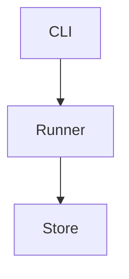

> 一份面向日常研发的 demo 说明书：解释它是什么、各模块如何协作、如何安装启动，以及排查问题时优先看哪些源码和文档。

源仓库：`https://example.com/demo.git`

本次分析的本地路径：`/Users/example/repo`

本次分析的提交：`abc1234 2026-10-12 init`

## 1. 一句话理解 demo

demo 是一个示例项目，入口在 `src/main.py`。

它由 `src/` 和 `scripts/` 两条主线组成。

它不是服务端程序；输入是命令行参数，输出是文件。

## 2. 核心心智模型

| 概念 | 来源 | 含义 |
|---|---|---|
| Runner | `src/runner.py` | 执行主循环 |
| Config | `config/settings.yaml` 的加载器 `src/config.py` | 读取配置 |
| Store | `src/store.py` | 持久化 |
| CLI | `src/main.py` | 参数解析 |
| Logger | `src/log.py` | 日志 |
| Plugin | `src/plugins/__init__.py` | 扩展点 |

## 3. 总体架构



这张图说明 `src/main.py` 调用 Runner，再写入 Store。

### 3.1 组件职责

| 组件 | 关键文件 | 职责 |
|---|---|---|
| Runner | `src/runner.py` | 主循环 |
| Store | `src/store.py` | 持久化 |

## 4. 项目如何工作

### 4.1 一次运行的主链路

1. `src/main.py` 解析参数。
2. `src/runner.py` 执行。

### 4.2 配置如何加载

1. `src/config.py` 读取 YAML。

## 5. 安装与启动

来自 `README.md` 的安装命令：

```bash
pip install -r requirements.txt
```

## 6. 常用命令 / 使用指南

### 6.1 运行

`python3 src/main.py --once`，见 `README.md`。

## 7. 配置项与环境变量

| 配置项 | 默认值 | 定义位置 |
|---|---|---|
| interval | 60 | `config/settings.yaml` |

## 8. 常见使用场景 / 推荐工作流

1. 首次运行：`python3 src/main.py --init`。

## 9. 源码入口索引

| 想了解 | 优先看 |
|---|---|
| 主循环 | `src/runner.py` |

## 10. 排错指南

| 现象 | 优先检查 | 依据 |
|---|---|---|
| 找不到配置 | 工作目录 | `src/config.py` |

## 11. 开发者视角的模块关系 / 维护注意点


改 `src/config.py` 的字段要同步改 `src/runner.py`。

## 12. 已知不确定点

- 本次为静态源码分析，未执行 `python3 src/main.py`。
- `src/store.py` 的并发语义未核实。

## 附录 A. 备注

附录内容不计入编号章节。

<!-- padding to satisfy the minimum length -->
<!-- pad 1 -->
<!-- pad 2 -->
<!-- pad 3 -->
<!-- pad 4 -->
<!-- pad 5 -->
<!-- pad 6 -->
<!-- pad 7 -->
<!-- pad 8 -->
<!-- pad 9 -->
<!-- pad 10 -->
<!-- pad 11 -->
<!-- pad 12 -->
<!-- pad 13 -->
<!-- pad 14 -->
<!-- pad 15 -->
<!-- pad 16 -->
<!-- pad 17 -->
<!-- pad 18 -->
<!-- pad 19 -->
<!-- pad 20 -->
<!-- pad 21 -->
<!-- pad 22 -->
<!-- pad 23 -->
<!-- pad 24 -->
<!-- pad 25 -->
<!-- pad 26 -->
<!-- pad 27 -->
<!-- pad 28 -->
<!-- pad 29 -->
<!-- pad 30 -->
<!-- pad 31 -->
<!-- pad 32 -->
<!-- pad 33 -->
<!-- pad 34 -->
<!-- pad 35 -->
<!-- pad 36 -->
<!-- pad 37 -->
<!-- pad 38 -->
<!-- pad 39 -->
<!-- pad 40 -->
<!-- pad 41 -->
<!-- pad 42 -->
<!-- pad 43 -->
<!-- pad 44 -->
<!-- pad 45 -->
<!-- pad 46 -->
<!-- pad 47 -->
<!-- pad 48 -->
<!-- pad 49 -->
<!-- pad 50 -->
<!-- pad 51 -->
<!-- pad 52 -->
<!-- pad 53 -->
<!-- pad 54 -->
<!-- pad 55 -->
<!-- pad 56 -->
<!-- pad 57 -->
<!-- pad 58 -->
<!-- pad 59 -->
<!-- pad 60 -->
<!-- pad 61 -->
<!-- pad 62 -->
<!-- pad 63 -->
<!-- pad 64 -->
<!-- pad 65 -->
<!-- pad 66 -->
<!-- pad 67 -->
<!-- pad 68 -->
<!-- pad 69 -->
<!-- pad 70 -->
<!-- pad 71 -->
<!-- pad 72 -->
<!-- pad 73 -->
<!-- pad 74 -->
<!-- pad 75 -->
<!-- pad 76 -->
<!-- pad 77 -->
<!-- pad 78 -->
<!-- pad 79 -->
<!-- pad 80 -->
<!-- pad 81 -->
<!-- pad 82 -->
<!-- pad 83 -->
<!-- pad 84 -->
<!-- pad 85 -->
<!-- pad 86 -->
<!-- pad 87 -->
<!-- pad 88 -->
<!-- pad 89 -->
<!-- pad 90 -->
<!-- pad 91 -->
<!-- pad 92 -->
<!-- pad 93 -->
<!-- pad 94 -->
<!-- pad 95 -->
<!-- pad 96 -->
<!-- pad 97 -->
<!-- pad 98 -->
<!-- pad 99 -->
<!-- pad 100 -->
<!-- pad 101 -->
<!-- pad 102 -->
<!-- pad 103 -->
<!-- pad 104 -->
<!-- pad 105 -->
<!-- pad 106 -->
<!-- pad 107 -->
<!-- pad 108 -->
<!-- pad 109 -->
<!-- pad 110 -->
<!-- pad 111 -->
<!-- pad 112 -->
<!-- pad 113 -->
<!-- pad 114 -->
<!-- pad 115 -->
<!-- pad 116 -->
<!-- pad 117 -->
<!-- pad 118 -->
<!-- pad 119 -->
<!-- pad 120 -->
<!-- pad 121 -->
<!-- pad 122 -->
<!-- pad 123 -->
<!-- pad 124 -->
<!-- pad 125 -->
<!-- pad 126 -->
<!-- pad 127 -->
<!-- pad 128 -->
<!-- pad 129 -->
<!-- pad 130 -->
<!-- pad 131 -->
<!-- pad 132 -->
<!-- pad 133 -->
<!-- pad 134 -->
<!-- pad 135 -->
<!-- pad 136 -->
<!-- pad 137 -->
<!-- pad 138 -->
<!-- pad 139 -->
<!-- pad 140 -->
<!-- pad 141 -->
<!-- pad 142 -->
<!-- pad 143 -->
<!-- pad 144 -->
<!-- pad 145 -->
<!-- pad 146 -->
<!-- pad 147 -->
<!-- pad 148 -->
<!-- pad 149 -->
<!-- pad 150 -->
<!-- pad 151 -->
<!-- pad 152 -->
<!-- pad 153 -->
<!-- pad 154 -->
<!-- pad 155 -->
<!-- pad 156 -->
<!-- pad 157 -->
<!-- pad 158 -->
<!-- pad 159 -->
<!-- pad 160 -->
